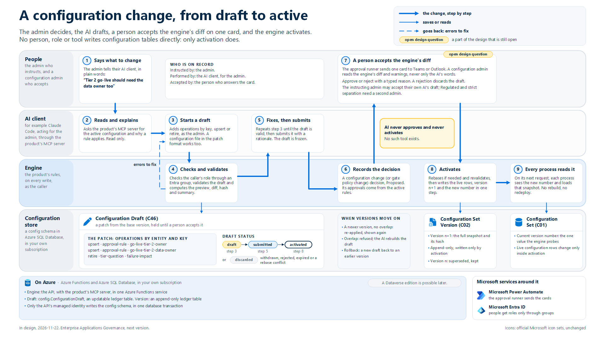
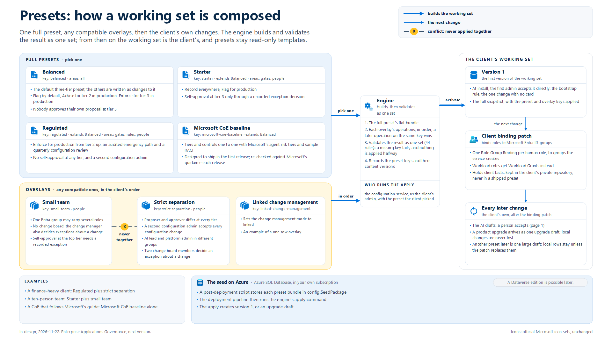
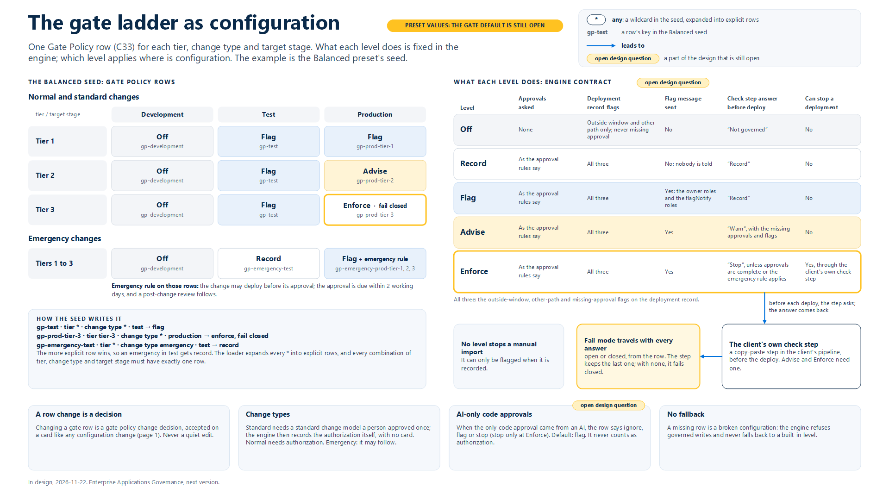

# Configuration and presets

**Status: in design.** This page describes how the next version is designed to hold everything an organization tailors. Nothing here is built or running.

## In one screen

1. **Everything an organization can tailor is a configuration row.** Tiers, lifecycle stages, gates, change types, roles, decision rights, approval rules, gate levels, documentation rules, review cadences and separation of duties are all rows. The engine never branches on a fixed tier number or label.
2. **One working set, many versions.** An organization has one working set in force. It changes only through versions. Each version is a full, hashed snapshot, exactly one version is active, and every operational record stamps the version it was judged by.
3. **AI proposes, a person accepts, the engine activates.** An AI client, acting for a configuration admin, builds a draft. The engine validates it and computes the difference. A person accepts that difference on an approval card. Only then does the engine activate the new version.
4. **Presets are shipped configuration sets.** Four full presets and three overlays ship. An organization picks one full preset, adds any compatible overlays, and owns the result.
5. **The gate ladder is configuration.** What each gate level does is fixed in the engine. Which level applies to which tier, change type and target stage is a configuration row.
6. **No silent fallback.** If a rule row the engine needs is missing, the engine refuses governed writes and reports the broken configuration. It never falls back to a built-in default.

## Three places a value can live

| Place | What lives there | Who changes it | How it changes |
|---|---|---|---|
| Configuration rows | Every business rule and every label | An AI client on a configuration admin's instruction, accepted by a person | A new configuration set version |
| The engine contract | The few fixed meanings the engine needs to enforce safety, such as "accepted", "final" or "person" | Only a product release | A new engine version, with a release note |
| Environment settings | Infrastructure switches needed before configuration can load, such as how often the engine checks for a new version | The installer or the platform admin | Set at deployment |

Nothing that decides who approves, what is required or how strict a gate is may live in the environment settings.

The engine contract is a short list of about 20 fixed meanings. Every label on top of them stays configurable. A client can rename "Accepted" to "Approved by board", but the engine still reads it as "accepted". **Open design question:** whether this short list fits the "never hardcoded" rule. The design assumes it does.

## Configuration entities

Configuration falls into four groups. The [data model](data-model.md) lists each entity.

| Group | Examples |
|---|---|
| Core | Configuration set, configuration set version, configuration draft, preset, setting, status, value list |
| Taxonomy | Tier, tier question, lifecycle stage, gate, gate requirement, application kind, component kind, dependency type, decision type, change type, standard change model, document type, review type, party, owner role, link kind, guideline |
| Rules | Decision right, approval rule, gate policy, separation rule, documentation requirement, review cadence, reminder rule |
| Roles and access | Role, role group binding (a role mapped to an Entra group), workload grant |

Every taxonomy row has a stable text key (such as `tier-3` or `emergency`), a label people see, an "is active" flag and an origin (shipped or local). Rows in use are retired, never deleted, and keys are never reused. So an old record always still resolves.

## Versions

A draft's status is stored on the draft. A version's state is worked out from the version numbers, because a version never changes once written.

| Draft status | What it means |
|---|---|
| Draft | Being prepared. Editable |
| Submitted | Frozen. Waiting for the approvals its rules need |
| Activated | Became a new version |
| Discarded | Withdrawn, rejected or expired. Kept as evidence of the proposal |

| Version state | What it means |
|---|---|
| Active | In force. Exactly one per working set |
| Superseded | A newer version exists. Kept forever, because records stamped with it still need it |

Each version holds the full snapshot, a SHA-256 hash of it, the change that was applied, the validation result, a plain summary computed by the engine, and the decision behind it. A record stamped with version 12 can prove which rules applied, even after the rules changed again.

## How a configuration change happens

| Step | Who | What happens |
|---|---|---|
| 1 | Configuration admin | Tells their AI client what should change, in plain words. Example: "Tier 2 go-live should need the data owner too" |
| 2 | AI client | Reads the active configuration and asks the product to explain the rule in question |
| 3 | AI client, for the admin | Starts a draft: a list of operations by key (add or update a row, retire a row) |
| 4 | Engine | Checks that the person holds a role that may change configuration, validates the draft, and computes the preview, the difference, the hash, the summary and the applications whose rules would change |
| 5 | AI client | Fixes any errors and submits the draft with a reason |
| 6 | Engine | Records a configuration change decision as Proposed and asks for the approvals the active rules require |
| 7 | Approver, a person | Reads the engine's difference on an approval card and approves or rejects it, with a typed reason |
| 8 | Engine | When the rules are met, writes the new version and the changed rows in one transaction |
| 9 | Engine, everywhere | The next request sees the new version. No rebuild and no redeploy |

The approval card shows the engine's own difference, never only the AI's description of it.

In the default presets, one configuration admin accepts the change, and that person may be the admin who gave the instruction. The Regulated preset and the strict separation overlay require a second configuration admin. **Open design question:** whether the instructing admin should always accept the exact difference on a card. The design assumes yes, one card that shows the difference.

### What an AI client may and may not do

| May | May not |
|---|---|
| Read the active configuration, any version and any difference | Approve, accept or activate anything. No such tool exists |
| Explain which rule applied to a record, and why | Write configuration rows or versions directly |
| Create, edit, validate, submit and withdraw drafts for the admin | Change a locked setting, or any rule that would make an AI an approver |
| Draft a configuration file in the same patch format | Supply its own difference as the truth. The engine computes it |
| Propose a revert to an earlier version | Hold any decision right other than "supports" |

### Safety floors

These are part of the engine contract. No configuration and no preset can turn them off.

1. AI never approves. Only an approved answer from a person counts.
2. Every decision is accepted on a card answered by a person. The only exceptions are a short, locked list of decisions the engine may accept by itself, and the first version at install.
3. Every configuration change is accepted by at least one person who holds a role that may change configuration, except the first version at install.
4. Activation happens only through an accepted decision. There is no activate tool or button.
5. A change to who may change configuration is judged by the active rules, not the proposed ones. A draft can never lower its own bar.
6. Rows in use are retired, never deleted. Keys are never reused.
7. The engine refuses governed writes when it cannot load a valid active version, or when a rule row it needs is missing.

The locked list in floor 2 has two entries in the design: intake at the lowest tier, and standard changes whose model a person approved once. **Open design question:** whether the engine may ever accept a decision without a person's card. The design assumes only this locked list.

### Rollback, records in flight, install and upgrades

- **Rollback.** There is no in-place rollback. "Go back to version 9" is a new draft whose change turns the active version into version 9's snapshot. It goes through the same validation and acceptance, so the history stays append-only.
- **Records in flight.** Approval requirements are fixed when a decision is submitted. A later version does not add or remove approvals for it. A deployment record is judged by the version active when it arrives.
- **Install.** No version exists before install, so no approval rules exist either. The person who installs applies the chosen preset, and that first version is accepted directly by that person and recorded as a decision. The next change maps the product roles to the organization's Entra groups. From then on, every change follows the steps above.
- **Upgrades.** A new product release never applies its changed presets by itself. The upgrade proposes one draft. Shipped rows the organization never touched are proposed as updates. Rows the organization changed are kept and listed as conflicts. Rows the organization added are untouched. A configuration admin accepts the draft like any other change, so local changes are never lost.

## Presets

| Preset | Kind | In one line |
|---|---|---|
| Balanced | Full | The default three-tier preset. The others are written as changes to it |
| Starter | Full | Lighter gates: record in test, flag in production. Self-approval at the top tier only through a recorded exception decision |
| Regulated | Full | Enforce in production from tier 2 up, an audited emergency path, a quarterly configuration review, no self-approval at any tier and a second configuration admin |
| Microsoft CoE baseline | Full | Tiers and controls that follow Microsoft's three agent risk tiers one to one, applied to every application kind |
| Small team | Overlay | One group may carry several roles. No change board. Self-approval at the top tier needs a recorded exception |
| Strict separation | Overlay | Different people for proposer and approver, and for the instructing and accepting admin. The AI lead and the platform admin in different groups |
| Linked change management | Overlay | Switches change management to linked mode, where an existing change tool keeps the workflow and the product stores its change number and link |

### Selecting and mixing

1. Pick one full preset and any overlays, in order. Overlays that conflict, such as small team and strict separation, cannot be combined.
2. The engine builds the content: the full preset first, then each overlay's operations in order.
3. The engine validates the result as one set. Nothing is applied halfway.
4. The result becomes version 1 at install, or a draft when an organization changes preset later.
5. From then on the working set belongs to the organization. Presets stay read-only templates.

Examples: a finance-heavy organization picks Regulated plus strict separation. A ten-person team picks Starter plus small team. A Center of Excellence that follows Microsoft's agent guidance picks the Microsoft CoE baseline.

### What Balanced holds

| Area | Default content |
|---|---|
| Tiers | Three, ranked 1 to 3. Each tier maps to three Microsoft vocabularies: Microsoft's agent risk tiers, the Copilot Studio governance zones and the Power Platform application support tiers |
| Tier questions | Five: data change, sensitivity, reach, agent autonomy (agents only) and failure impact. The most serious answer wins |
| Stages and gates | Eleven lifecycle stages, from idea to retirement, and five gates: Accept, Commit, Design, Go-live and Value |
| Decision types | Sixteen, each with its allowed outcomes |
| Change management | Built in. Standard (needs a pre-approved model), normal and emergency (authorization may follow, with a review after) |
| People | Seven parties, eight owner roles, 14 human roles and 2 workload roles |
| Approval rules | The business owner by default. The change manager at tier 3 and for emergencies. The change board for exceptions about a change. Business owner, then security reviewer, for tier 3 go-live. A configuration admin for configuration changes |
| Separation | Nobody approves their own proposal at tier 3. The deployer is not the only approver of a production change, which is flagged |
| Documentation | A wiki page for every application from build. A runbook at tiers 2 and 3. An architecture decision record at tier 3. A support guide at tier 3 |
| Reviews | Owner check yearly, twice a year or quarterly by tier. Tier check and benefit review yearly. Access check by tier |

The three Microsoft vocabularies exist on their own Learn pages: Microsoft's agent guidance uses three risk tiers ([Learn](https://learn.microsoft.com/agents/center-of-excellence/govern-agents-risk)), Copilot Studio governance separates agent creation into three zones ([Learn](https://learn.microsoft.com/microsoft-copilot-studio/guidance/sec-gov-phase2)), and Power Platform adoption guidance defines three application tiers for support: Productivity, Important and Critical ([Learn](https://learn.microsoft.com/power-platform/guidance/adoption/support-strategy-solutions#define-tiers-of-applications)). All three were checked on 2026-11-22. No Microsoft page joins them. The mapping between them is the product's own default configuration, and each mapping row stores the term, the source link and the date it was checked.

### The Microsoft CoE baseline

This preset lets a Center of Excellence that starts from Microsoft's agent guidance adopt the product without remapping. Microsoft's guidance lists required controls for each tier ([Learn](https://learn.microsoft.com/agents/center-of-excellence/govern-agents-risk), checked 2026-11-22). The preset turns each control into configuration rows. For example:

| Microsoft control | Configuration in the preset |
|---|---|
| Tier 1: "A named owner who is accountable for the agent" | A gate requirement on Accept: a business owner is assigned |
| Tier 2: "A formal release gate with review before the agent goes live" | A release review that must be done before Go-live at tier 2. Gate level advise in production |
| Tier 3: "A security review and a responsible AI assessment before release" | Two review types that must be done before Go-live at tier 3 |
| Tier 3: "A decision-rights framework that sets what the agent may decide alone and what needs a human" | An accepted autonomy level decision before Go-live for agents at tier 3 |
| Tier 3: "A quarterly maturity review" | A maturity review every 90 days at tier 3 |

Microsoft's agent front door guidance also says the agent "recommends a route" and "doesn't approve the work" ([Learn](https://learn.microsoft.com/agents/center-of-excellence/agent-front-door), checked 2026-11-22). In the preset, AI holds only the "supports" right on intake.

The preset is designed to be checked against Microsoft's guidance again with each product release.

## The gate ladder

There is one gate policy row for each active tier, change type and target stage, and optionally for each portfolio. Every combination must resolve to exactly one row. Adding a tier or a change type therefore forces the same draft to add its gate rows, and the validator names any that are missing. Changing a gate row is itself a recorded decision.

### What each level does

| Gate level | Approvals asked | Deployment flags | Flag message sent | Answer to a pipeline check step | Can stop a deployment |
|---|---|---|---|---|---|
| Off | None | None | No | "Not governed" | No |
| Record | As the approval rules say | Outside window, other path, missing approval | No | "Record" | No |
| Flag | As the approval rules say | All three | Yes, to the owners and named roles | "Record" | No |
| Advise | As the approval rules say | All three | Yes | "Warn", with the missing approvals | No |
| Enforce | As the approval rules say | All three | Yes | "Stop", unless approvals are complete or the emergency rule applies | Yes, through your own check step |

No level can stop a manual import. It can only be flagged when it is recorded. Advise and enforce need a check step in your own pipeline. In Azure Pipelines, for example, approvals and checks are set on resources such as environments, and the checks include Invoke REST API and Business Hours ([Learn](https://learn.microsoft.com/azure/devops/pipelines/process/approvals), checked 2026-11-22).

- **Fail mode.** At enforce, each row says what happens when the product cannot answer: fail open (go and flag) or fail closed (stop). Every answer carries the fail mode, and the step sample is designed to keep the last value it received.
- **Emergency rule.** For change types that allow authorization after the change, the row says whether an emergency may deploy first, how many working days the authorization may follow, and which review follows. An emergency that uses this path stays flagged until its approval and review are done.
- **AI-only code approvals.** When a pipeline step reports that the only code approval came from an AI, the row says whether to ignore it, flag it or stop at enforce. The shipped default is flag. Such an approval never counts as authorization. **Open design question:** whether AI approvals from other tools should ever count. The design assumes they never do.

### Preset values in production

| Tier | Starter | Balanced | Regulated | Microsoft CoE baseline |
|---|---|---|---|---|
| Tier 1, normal and standard changes | flag | flag | flag | record |
| Tier 2, normal and standard changes | flag | advise | enforce, fail open | advise |
| Tier 3, normal and standard changes | flag | enforce, fail closed | enforce, fail closed | enforce, fail closed |
| Any tier, emergency | flag | flag, with the emergency rule | enforce, with the emergency rule | flag, with the emergency rule |

Development targets are off in every preset. **Open design question:** which preset installs first, and whether a check step should ever stop a deployment. The values above are preset values, not decisions.

## The seed files

Presets ship as JSON files, one bundle per preset. Rows refer to each other by stable key, never by internal ID. A JSON Schema checks the shape of each file, and the engine's validator checks its meaning, such as complete gate coverage, one accountable per decision right, and no rule that makes an AI an approver. Every shipped preset is designed to pass the same validator in the product build as in your own database.

The seed is never the live copy. The live copy is the active version in your database. An organization that wants its configuration in source control exports the active version as files after each activation.

Shipped presets hold no secrets and no tenant identifiers. The patch that maps roles to your own Entra groups holds your facts, so it stays in your own private repository.

## How the engine reads configuration

- The engine reads only the active version's snapshot, never the live rows.
- It keeps one compiled snapshot per version in memory, and checks the active version number on every request.
- An activated change applies on the next request. No rebuild and no redeploy.
- The cache is only for speed. Correctness never depends on it.

## The Azure binding

| Concern | Design |
|---|---|
| Where configuration lives | The `config` schema in Azure SQL Database |
| Complex structures | Native `json` columns. Microsoft says the `json` data type is generally available in Azure SQL Database, and its input must be a JSON object or a JSON array ([Learn](https://learn.microsoft.com/sql/t-sql/data-types/json-data-type), checked 2026-11-22) |
| Versions | An append-only ledger table, so a version can never be changed or deleted. See the [data model](data-model.md) |
| Who writes configuration tables | Only the activation operation. A row-level security block predicate refuses any other write, whoever the caller is |
| Seed | Loaded at install and applied by the same engine code |
| Activation | One database transaction: the changed rows, the new version, the version number and the draft's outcome |
