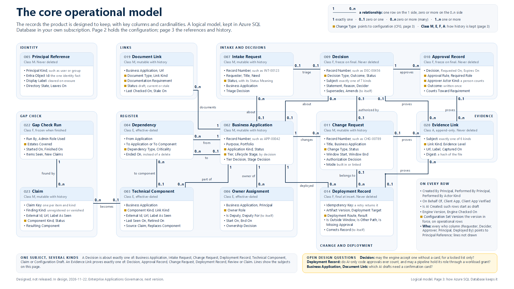
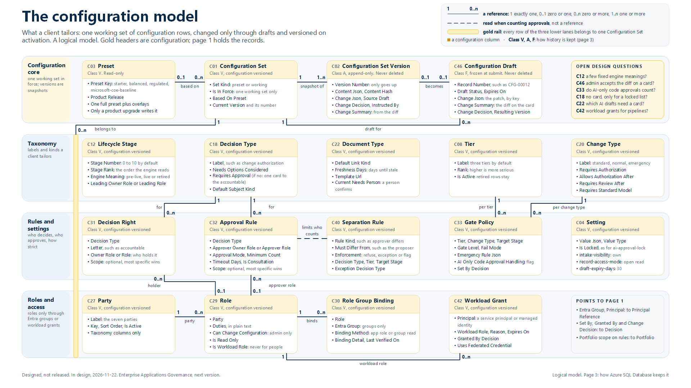
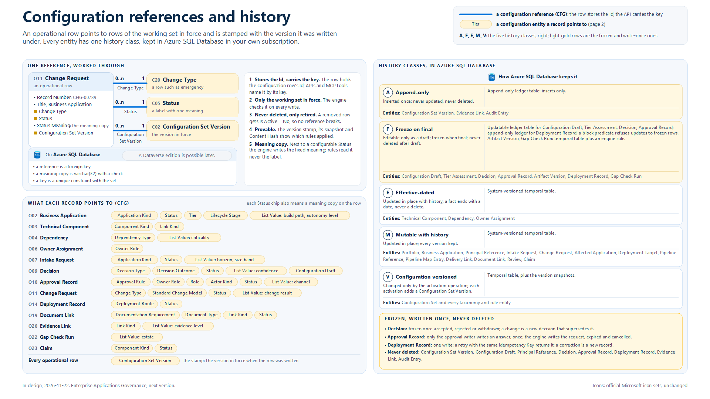

# Data model

**Status: built and tested; runs as a demo install with fictional data; no release yet.** This page describes the logical data model and its binding to Azure SQL Database. The model is in [`src/model`](../../src/model/), and the Azure SQL scripts are in [`src/adapters/azure/sql`](../../src/adapters/azure/sql/), under the MIT License. The demo install runs on those scripts. The store tests run on SQLite and in memory in every build; their Azure SQL cases need a SQL Server and are opt-in, so the database-side controls below (ledger tables, row-level security) are built but stay "as designed" until those cases run in the build.

## In one screen

1. **77 entities in the first release:** 50 for configuration (4 of them still proposals) and 27 for operational records, plus 4 kept for later. Seven of them hold the [data taxonomy](data-taxonomy.md).
2. **Configuration at the center.** Operational rows point to configuration rows inside the one working set in force. APIs and MCP tools carry configuration keys, never internal IDs. A live configuration row is never deleted, only retired, so no reference ever breaks.
3. **Fixed meanings are copied onto rows.** Where an operational row has a configurable status, the engine also writes the fixed meaning next to it, such as "accepted" next to the label "Approved by board". The engine, row-level security and views read that one column.
4. **Five history classes.** Every entity has one: append-only, freeze on final, effective-dated, mutable with history, or configuration versioned.
5. **Decisions are append-only in effect.** A decision can change only while it is proposed. A change after that is a new decision that supersedes the old one.
6. **Approval records are immutable once answered.** The answer is written once: the person's own answer on the decision page, or, where an organization keeps cards, the approval runner's for a card. Only an approved answer from a person who holds the required role counts.
7. **Deployment records are written once.** A retry with the same key returns the existing record. A correction is a new record that names the one it corrects.
8. **Every row says who performed it,** as what kind of actor, through which client, on behalf of whom, and under which configuration version.
9. **Links, not copies.** For anything another tool owns, the model holds the tool's ID, a link, a label as last seen and a "last seen" date.
10. **Small volumes.** For a 5,000-person organization, the planning estimate is about 43,000 operational rows in year 1 and about 172,000 by year 5, under about 2.5 GB of data.

## The core operational model

| Entity | What it holds | Main relationships | History class |
|---|---|---|---|
| Portfolio | A business grouping of applications. Portfolios can nest. The default labels two levels: portfolio and application group | Parent portfolio (self) | Mutable with history |
| Business application | The register's central record: one thing the business runs and answers for | Portfolio, application kind, tier, lifecycle stage, status | Mutable with history |
| Technical component | One part of an application inside a tool, held as the tool's ID, a link and a "last seen" date | Business application, component kind, link kind, optional deployment target | Effective-dated |
| Dependency | A typed, directed link: this application needs that application or component | From one application; to exactly one application or component; dependency type | Effective-dated |
| Principal reference | A minimal reference to a directory object: a user, a group, an agent identity, a service principal or a managed identity | Referenced by every "who" column | Mutable with history |
| Owner assignment | One person holding one owner role for one subject (an application, a data domain or a data location), with a deputy and start and end dates | One subject, owner role, principal | Effective-dated |
| Intake request | One request through the front door: a new idea, or an app already built that needs registering | Requester, optional business application, status | Mutable with history |
| Tier assessment | One set of tier answers and the tier they suggest | Intake request or business application; the tier decision | Freeze on final |
| Decision | One entry in the append-only decision log: what was decided, about what, by whom, when and why | Decision type, outcome, status, decider, one subject, optional supersedes and amends | Freeze on final |
| Approval record | One required approval for one decision: who was asked, who answered, the answer, the typed reason | Decision, approval rule, approver | Freeze on final |
| Change request | One planned change, with type, window, authorization and result | Main business application, change type, optional standard change model, authorization decision | Mutable with history |
| Affected application | A further application a change touches | Change request, business application | Mutable with history |
| Artifact version | One version of one deployable artifact: a solution, a package, an image or a commit | Business application | Freeze on final |
| Deployment record | One artifact version reaching one target: what, where, when, by which pipeline, by which route, with which result and flags | Business application, artifact version, deployment target, route, optional change request and pipeline | Freeze on final (final at insert) |
| Deployment target | A place deployments land, such as a Power Platform environment or an Azure resource group, held as a link | Target stage, change path, link kind | Mutable with history |
| Pipeline reference | A link to one of your pipelines. The product never builds, hosts or runs it | Link kind | Mutable with history |
| Pipeline map entry | This pipeline deploys this application to this target | Business application, pipeline reference, deployment target | Mutable with history |
| Delivery link | A link from an application, change or intake to work in another tool, such as an Azure Boards work item | One subject, link kind | Mutable with history |
| Document link | One recorded document for one application: link, status, owner, last updated and last checked | Business application, document type, optional documentation requirement | Mutable with history |
| Evidence link | A link from a record to proof held elsewhere, such as a test result | One subject, link kind | Append-only |
| Review | One periodic or event check on an application, such as an owner check. It ends with a decision | Business application, review type, reviewer, outcome decision | Mutable with history |
| Gap check run | One run of the gap check: who ran it, with which admin role, over which estates, and what it found | The admin who ran it | Freeze on final |
| Claim | One item on the claim list: an unregistered item the gap check found, or a registered component it no longer sees | Gap check run, component kind, optional resulting component | Mutable with history |
| Audit entry | One product event, append-only | The row it is about, the actor | Append-only |
| Data location | One store of any vendor, held as a link | Data platform, target stage, optional parent location, optional deployment target | Effective-dated |
| Data mapping | This data domain's data sits at this location, with its origin | Data domain, data location | Effective-dated |
| Data use | This application reads or writes this data domain, with or without AI | Business application, data domain, optional data location | Effective-dated |

The three data entities, and the configuration entities behind them (data classification, data domain level, data domain and data platform), are described in [Data taxonomy](data-taxonomy.md).

A document that is required but has no link yet is shown as "missing". "Missing" is worked out from the documentation rules when it is read, and is never stored as a row.

## The configuration model

| Group | Entities |
|---|---|
| Core | Configuration set, configuration set version, configuration draft, preset, setting, status, value list, list value |
| Taxonomy | Tier, tier question, tier answer option, vocabulary mapping, lifecycle stage, gate, gate requirement, application kind, component kind, dependency type, decision type, decision outcome, change type, standard change model, document type, review type, party, owner role, target stage, change path, deployment route, link kind, actor kind, guideline |
| Rules | Documentation requirement, review cadence, reminder rule, decision right, approval rule, gate policy, separation rule |
| Roles and access | Role, role group binding, workload grant |
| Data | Data classification, data domain level, data domain, data platform |

Every configuration row belongs to one configuration set. A configuration draft becomes a new configuration set version only when it is activated. See [Configuration and presets](configuration-and-presets.md).

### Main relationships

Cardinality is written from parent to child. "1 to many" means one parent has zero or more children, and each child has exactly one parent.

| Child | Parent | Cardinality | Note |
|---|---|---|---|
| Business application | Portfolio | 1 to many, optional on the child | |
| Technical component | Business application | 1 to many | |
| Dependency | Business application (from) | 1 to many | Points to exactly one application or component |
| Owner assignment | Business application, data domain or data location; owner role; principal | 1 to many each | Exactly one subject |
| Tier assessment | Intake request or business application | 1 to many | Exactly one of the two |
| Decision | Decision type | 1 to many | One subject of several possible kinds |
| Decision | Decision (supersedes) | 1 to at most 1 | A decision supersedes at most one other |
| Approval record | Decision | 1 to many | |
| Change request | Business application | 1 to many | |
| Affected application | Change request | 1 to many | The only cascading delete, and only while the change is a draft |
| Deployment record | Business application, artifact version, deployment target | 1 to many each | |
| Deployment record | Change request, pipeline reference | 1 to many, optional | |
| Deployment record | Deployment record (corrects) | 1 to many, optional | |
| Pipeline map entry | Business application, pipeline reference, deployment target | 1 to many each | One row per unique triple |
| Document link | Business application | 1 to many | |
| Review | Business application | 1 to many | |
| Claim | Gap check run | 1 to many | |
| Every operational row | Configuration set version | 1 to many | The version in force when the row was written |
| Every row | Principal reference (created by, performed by, on behalf of) | 1 to many | Principal references are never deleted |
| Every configuration row | Configuration set | 1 to many | |
| Approval rule, decision right | Decision type | 1 to many | Optional scope: tier, stage, change type, application kind, target stage, portfolio |
| Gate policy | Tier, change type, target stage | 1 to many each | One row per unique combination, optionally per portfolio |
| Role group binding | Role; an Entra group | 1 to many | Groups only |
| Workload grant | Role; a service principal or managed identity | 1 to many | Never an agent identity |

Every relationship except the one cascade restricts deletes: a parent can't be deleted while children point to it.

### Subjects of several kinds

A decision, a delivery link and an evidence link each belong to one subject of several possible kinds. For example, a decision can be about an application, an intake request, a change request, a deployment, a component, a claim or a configuration draft. The model gives each allowed kind its own optional reference and a check that exactly one is set and that it matches the subject kind.

## Who performed each write

Every row carries the same set of columns. The engine sets them. No caller sets them directly.

| Column | What it holds |
|---|---|
| Created by principal | The person or workload that created the row. Never changes |
| Performed by principal | The person or workload behind the last write |
| Performed by actor kind | Person, AI client for a person, agent identity, pipeline, approval runner, or engine |
| On behalf of | The person an AI client or pipeline acted for. Empty when a person acted directly |
| Client app | The MCP client or app behind the last write, such as "Claude Code" or the product's web app |
| Client app verified | Yes when the client app came from a validated token claim |
| Is AI created | Yes when an AI client created the row. Such rows start as Draft or Proposed |
| Configuration set version | Operational rows only: the version in force when the row was written |
| Engine version and engine checked on | The engine stamp. A later change date with no newer stamp shows a write that went past the engine, which a scheduled read-only check finds and records |

## History classes

| Class | Rule | Entities | Azure SQL binding |
|---|---|---|---|
| Append-only | Inserted once. Never updated, never deleted | Configuration set version, evidence link, audit entry | Append-only ledger table |
| Freeze on final | Editable only while in its draft state. Frozen when it reaches a final state | Configuration draft, tier assessment, decision, approval record, artifact version, deployment record, gap check run | Updatable ledger table for tier assessment, decision and approval record, with a block predicate that refuses updates to frozen rows. Append-only ledger table for deployment record. Configuration draft, artifact version and gap check run keep history and are frozen by the engine; drafts also by a block predicate |
| Effective-dated | Updated in place with history. A fact is ended with a date, never deleted | Technical component, dependency, owner assignment | Temporal table |
| Mutable with history | Updated in place. Every version kept | Most other operational entities | Temporal table |
| Configuration versioned | Updated only by the activation operation. Each activation writes an immutable snapshot | Configuration entities | Temporal table, plus the version snapshots |

### Decisions

| State | Who moves it there | What may change |
|---|---|---|
| Proposed | A person, an AI client or the engine creates it | Every content column |
| Accepted | The engine, when every required approval counts and the decider is a person who holds the accountable right | Nothing |
| Rejected | The engine, when a required approval is rejected or the decider rejects | Nothing |
| Withdrawn | The proposer or the decider, before acceptance | Nothing |

To change an accepted decision, a person proposes a new decision that points to the old one. When the new one is accepted, the old one reads as superseded. "Superseded" is worked out from the later decision, so the frozen row is never touched. This follows Microsoft's guidance for architecture decision records: "The ADR serves as an append-only log. Don't go back and edit accepted records" ([Learn](https://learn.microsoft.com/azure/well-architected/architect-role/architecture-decision-record), checked 2026-11-22).

An AI client can propose a decision. It can never accept one.

### Approval records

| Columns | Engine | Approval runner | Anyone else |
|---|---|---|---|
| The request: decision, rule, required role, who was asked, requested on, expires on | Writes when the record is created | Never | Never |
| The answer: approved, rejected or recommendation only, with the approver, the approver's kinds, the typed reason, the time and the run link | Writes once, while pending, when the person the request asks answers on the decision page | Writes once, while pending, for an answer given on a card, where an organization keeps cards | Never |
| Expired or canceled | Writes, while pending | Never | Never |
| Counts toward requirement | Computes when the answer is written | Never | Never |
| Anything, after the answer is final | Never | Never | Never |

An answer counts only when the approver's actor kind is person and the approver is a user, not an agent. An answer from an AI stage in your own approval flow is stored as "recommendation only" and never counts.

### Deployment records

1. **One write.** A pipeline step, the owner's AI tool or a person sends a complete record after the deploy. There is no "in progress" record.
2. **Safe retry.** A second write with the same idempotency key returns the existing record. If its content differs, the engine refuses it and writes an audit entry.
3. **Correction.** A wrong record is never edited. A new record points to the one it corrects.
4. **Flags are facts at write time.** Outside window, other path and missing approval are worked out from the change request, the target's change path and the gate policy in force when the record arrives. They are never worked out again later.
5. **Never fail the deployment.** A pipeline step that cannot write warns and lets the deployment finish. A missed write later shows up as a deployment the product never heard of.

## The gap check claim

The gap check runs only when an admin asks, as that admin. Microsoft says the inventory API "currently supports only delegated user authentication", and that requests from a service principal or managed identity return HTTP 403 Forbidden ([Learn](https://learn.microsoft.com/power-platform/admin/inventory-api), checked 2026-11-22).

| Stored on the claim | Not stored |
|---|---|
| The Microsoft ID, the source type, a link, the label and environment label as seen, the last-seen date and run, and how many runs saw it | Any other inventory property, such as creation date, connectors, usage or region |
| A suggested claimant: the person Microsoft listed as owner at check time, as a hint only | Microsoft's owner as a fact |
| One claim per item and finding kind | A copy of the inventory, a snapshot of a run, or a list of everything seen |

When an owner claims an item, the engine creates a technical component on the owner's application with the Microsoft ID, the link, the label and the last-seen date. A registered component that a run no longer sees becomes a "vanished" claim. The engine never retires the component by itself. A person confirms whether it is gone or moved.

## Deletes, personal data and erasure

| Scope | Rule |
|---|---|
| Configuration rows | Never deleted. Retired |
| Operational drafts | The engine can delete a draft on a person's instruction, with its owned children |
| Operational rows after draft | Never deleted. An application is archived, a request is withdrawn or canceled, a link is ended with a date |
| Never deleted at all | Configuration set version, configuration draft, principal reference, decision, approval record, deployment record, evidence link, audit entry |

- **Person facts live in one place.** Only the principal reference holds a person's display label and Entra object ID. Every other row holds only a reference to it.
- **Free text stays business text.** Reasons and statements name roles and applications, not people. The playbook states this rule. People can still break it, so it is a risk that remains.
- **Erasure** clears the display label to "former user". History rows stay intact, because they hold only the reference.
- **Audit entries hold IDs, not labels.**

## The Azure SQL binding

As built, the SQL scripts create one table per first-release entity in its schema, with its history class applied: temporal tables, updatable ledger tables and append-only ledger tables, and one row-level security policy over every product table. The host's own tables (rate limits, the approval outbox, store keys, record numbers and the schema version) sit in a `host` schema outside the policy, and they are neither ledger nor temporal tables. Both stores, Azure SQL and SQLite, keep each row's columns as JSON beside a few real columns, and the database enforces most of the model's keys through unique indexes and a store key table. The fully typed schema in the rules below is the target of a later migration. The separate database identity for approval answers and the storage of ledger digests are designed, not built. See the [SQL scripts' README](../../src/adapters/azure/sql/README.md).

### Rules for every table

| Item | Design |
|---|---|
| Schemas | `config` for configuration, `ops` for operational records, `audit` for audit entries, `security` for row-level security functions, and `host` for the host's own tables, outside row-level security |
| Keys | A generated unique identifier per row. Configuration keys are lowercase letters, digits and hyphens, with a check constraint |
| Foreign keys | One per reference. Restrict on delete, except the one cascade |
| Fixed meanings | Short text columns with a check constraint that lists the allowed meanings |
| JSON | Native `json` columns ([Learn](https://learn.microsoft.com/sql/t-sql/data-types/json-data-type), checked 2026-11-22) |
| Mutable history | System-versioned temporal tables. Microsoft describes a temporal table as one "designed to keep a full history of data changes", with previous row versions stored in a history table ([Learn](https://learn.microsoft.com/sql/relational-databases/tables/temporal/overview), checked 2026-11-22) |
| Frozen and append-only records | Ledger tables, listed below |
| Database principals | The service's managed identity, used by the engine for all ordinary reads and writes. A separate identity used only to write approval answers. A third used only for schema upgrades. No human logins, except a break-glass Entra admin |
| Who the person is | The engine connects with its managed identity and puts the person's ID, roles and other facts in the session context, read-only for the life of the connection |

### Ledger tables

| Ledger table type | Entities |
|---|---|
| Updatable ledger table | Tier assessment, decision, approval record |
| Append-only ledger table | Configuration set version, deployment record, evidence link, audit entry |

What Microsoft says about ledger tables (all checked 2026-11-22):

- Append-only ledger tables "allow only `INSERT` operations", so privileged users such as database administrators can't alter data through ordinary data changes ([Learn](https://learn.microsoft.com/sql/relational-databases/security/ledger/ledger-append-only-ledger-tables)).
- Updatable ledger tables keep the previous version of each row in a history table, and both kinds "provide tamper-evidence and digital forensics capabilities" ([Learn](https://learn.microsoft.com/sql/relational-databases/security/ledger/ledger-overview)).
- Database digests can be generated and stored automatically in immutable Azure Blob Storage or in Azure Confidential Ledger. Ledger can't stop someone who controls the machine from editing database files, but it "guarantees that any tampering will be detected" when the data is verified ([Learn](https://learn.microsoft.com/sql/relational-databases/security/ledger/ledger-overview)).
- A ledger table can't be turned back into an ordinary table, deleting older data in ledger tables isn't supported, and automatic digest storage in immutable blobs can't use locally redundant storage ([Learn](https://learn.microsoft.com/sql/relational-databases/security/ledger/ledger-limits)).

Because ledger rows can never be deleted, the design pairs them with the free-text rule, label-clearing erasure and a documented legal basis for keeping the evidence.

### Row-level security as designed

Microsoft's row-level security has two kinds of predicate: filter predicates "silently filter the rows available to read operations", and block predicates "explicitly block write operations" that break the rule. For apps where many people share one database user through a middle tier, the app sets the user's ID in `SESSION_CONTEXT`, and setting `@read_only` to 1 stops the value from changing until the connection closes ([Learn](https://learn.microsoft.com/sql/relational-databases/security/row-level-security), checked 2026-11-22). The design uses this pattern. Each predicate is a function in the `security` schema.

| Predicate | Kind | What it does |
|---|---|---|
| Has a product role | Filter, every table | Rows are visible only to a caller who holds at least one product role |
| Can read audit | Filter, audit entries | Only the auditor, platform admin and configuration admin roles read audit entries |
| Can read intake | Filter, intake requests | By default, the requester sees their own requests, and the PMO, platform admin and architect roles see all. A setting can open them to every role |
| Can read claims | Filter, gap check runs and claims | By default, the platform admin and AI lead roles see all, and a person sees claims where they are the suggested or actual claimant. A setting can open them to every role |
| Can read portfolio | Filter, every operational table tied to an application | Off by default (open read). In portfolio read mode, a caller sees only applications in the portfolios their groups reach, while the auditor, platform admin and architect roles see all |
| Configuration writer | Block, configuration tables | Only the activation operation may write. No role is enough on its own |
| Draft writer and draft open | Block, configuration drafts | Only the engine's draft operations write drafts, for a caller with a role that may change configuration, and only while the draft is editable |
| Decision open | Block, decisions | A decision can be updated only while it is proposed |
| Approval pending | Block, approval records | An approval record can be updated only while it is pending |
| Approval answer writer | Block, approval records | Only the approval-writing identity may set approved, rejected or recommendation only. The engine may set only pending, expired or canceled |
| Assessment open | Block, tier assessments | A tier assessment can be updated only until its tier decision is set |

Each temporal history table gets its own filter predicate, so history follows the same read rules as current rows. Row-level security here is defense in depth: the engine checks every request first, and the database refuses what slips past.

## Capacity

Planning figures for a 5,000-person organization, not measurements. About 600 applications registered in year 1 and 150 more each year, about 150 change requests and 500 deployments a month.

| Entity | Year 1 | By year 5 |
|---|---|---|
| Business application | 600 | 1,200 |
| Technical component | 1,800 | 4,000 |
| Decision | 4,000 | 20,000 |
| Approval record | 5,000 | 25,000 |
| Change request | 1,800 | 9,000 |
| Deployment record | 6,000 | 30,000 |
| Claim | 3,000 | 6,000 |
| All operational rows | about 43,000 | about 172,000 |
| Audit entries (the full change log) | about 120,000 | about 600,000 |

Estimated Azure SQL data, including history: about 0.4 to 0.6 GB in year 1 and about 1.5 to 2.5 GB by year 5. Storage is not what drives the running cost.
