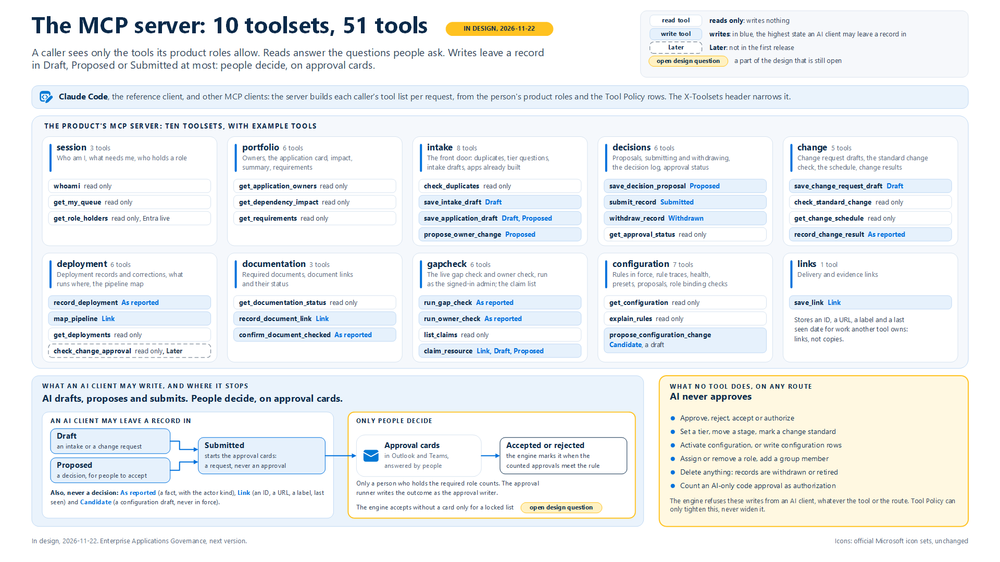
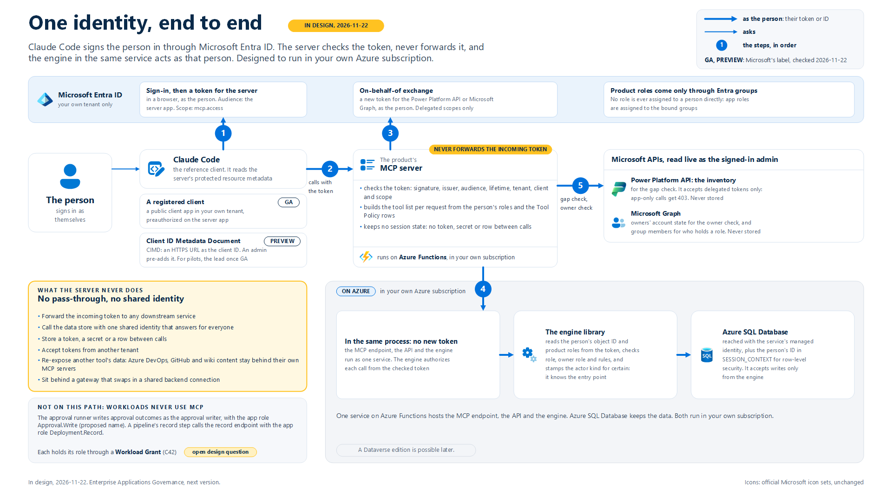
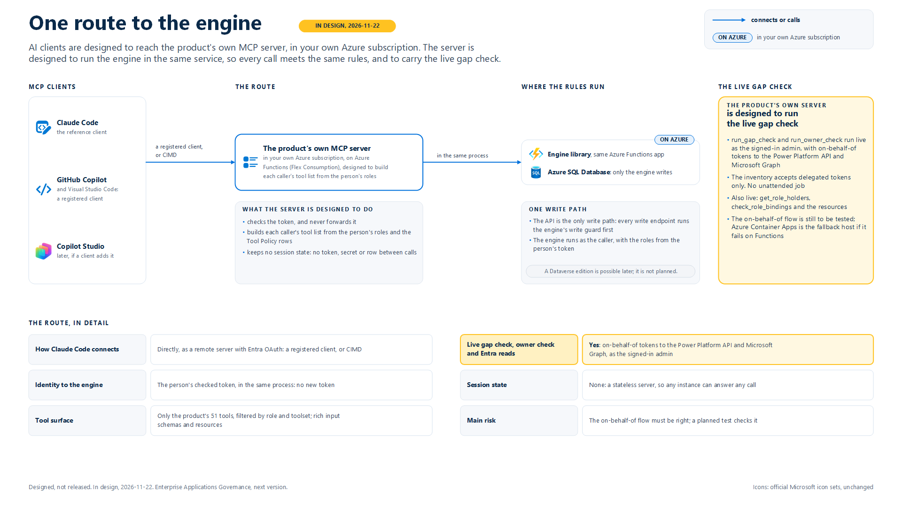

# MCP tools

**Status: built and tested; runs as a demo install with fictional data; no release yet.** This page describes the product's own MCP server: its toolsets and tools, the identity path, and what AI may and may not write. The server core and its contracts are in [`src/mcp`](../../src/mcp/), and the Azure host that serves the MCP endpoint and the REST API is in [`src/adapters/azure`](../../src/adapters/azure/README.md), under the MIT License. The MCP tests run each of the 101 first-release tools against its contract and cover every fixed error code; the one tool left, `check_change_approval`, waits for an open design question. The sign-in path has run with test tokens and on the demo install, not yet in an organization's own tenant. For connecting Claude Code, see the [Claude Code and MCP guide](../../src/docs/mcp.md).

## In one screen

1. **102 tools in 11 toolsets.** A caller sees only the tools its product roles allow, and can narrow the list further to the toolsets it needs. Eight tools are served only to a person in the product's web app, never to an AI client: `answer_approval`, `complete_review`, `complete_change`, `save_deployment_target`, `save_portfolio`, `run_due_state_refresh`, `renew_approval_request` and `retry_approval_card`. Eight reads serve the web app's screens: one decision, the approval requests, the intake list and record, reviews and one review, portfolios and owner assignments across the portfolio. Two more serve the PMO's demand list and the people pickers: `score_intake_request` and `find_people`. Ten serve the remaining screens: the audit trail, the evidence pack, the AI activity, the tier assessment, the documentation list, the deployment targets and their registration, the gap check runs, and the dependency and portfolio writes. One more, `find_records`, finds a record by its number (DEC-0123) for the web app's global search. Ten more are the data toolset: which business data domains exist and who owns them, which stores of any vendor hold which data, which domain a table belongs to, whether an app may use some data and who is asked, the data gaps, and the writes for data uses, locations, mappings and moving rows between domains. Eight more serve the last screens: the configuration versions and drafts and one draft, who holds each role and what it may do, the guidelines and playbook chapters, the measures and slide-back signals, the Admin page, the agents, and a security review request. Two more list the teams and committees and open one team: who is in it, the roles it holds, the decisions it answers, the applications it supports and what waits on it now. Two more list the data uses and the data mappings across every domain, one row by its ID too. Four more keep approval requests alive and load data domains: ask an expired request again, send a stuck approval card again, tell a demo presenter which story requests expire soon, and turn a CSV or a catalog list into a configuration draft of data domains.
2. **Reads answer the questions people ask:** "who owns this app?", "what breaks if it retires?", "what does my tier need?", "what needs me?", "what documentation is missing or stale for my app?" and "who still has to answer this decision?". Reads that return records say whether an AI client created each one and who last wrote it, exactly as the engine stamped it.
3. **Writes stop short of a decision.** A tool an AI client is served can leave a record as Draft, Proposed, Submitted (a request, never an approval), as reported, as a link, or as a configuration draft. No tool sets a tier, moves a stage, activates configuration, assigns a role or deletes. A person answers an approval request they were asked on the product's decision page, through `answer_approval`; the engine accepts the decision when the counted answers meet the rule.
4. **On behalf of the person, end to end.** The server checks the person's token, never forwards it, and reaches the data on behalf of that person.
5. **Claude Code is the reference client.** It is designed to connect as a client registered in your own Entra tenant first.
6. **Stateless.** No session state lives in the server between calls. Any instance can answer any request.

## Rules every tool follows

1. **On behalf of the signed-in person.** The server never answers with one shared identity's rights.
2. **AI never approves.** The engine refuses approval, acceptance, tier, stage, activation and role writes from an AI client, whatever the tool. The one tool that records an approval answer is served only to a person in the web app.
3. **AI-created rows start as Draft or Proposed.** Facts an AI client reports, such as a deployment, are stored "as reported", with the actor kind.
4. **Tools are configuration too.** Which role may call which tool, the highest state an AI client may leave a record in, and rate limits are configuration rows. Configuration can only tighten the limits the engine sets, never widen them.
5. **Roles come only through Entra groups.** The server reads roles from the token. It never assigns a role.
6. **Links, not copies.** Tools store an ID, a link, a label and a "last seen" date for anything another tool owns. Entra rosters and Microsoft's inventory are designed to be read live and never stored (tested over recorded fictional responses; a demo install reads its fictional personas).
7. **Stateless.** See below.
8. **No gateway holds a shared credential.** A gateway in front of the server must pass the caller's own token through.

## Toolsets

A client can ask for only the toolsets it needs with an `X-Toolsets` request header, for example `X-Toolsets: portfolio,documentation`. Without the header, the caller gets every toolset its roles allow. A short tool list helps an AI client choose the right tool.

| Toolset | What it covers | Tools |
|---|---|---|
| `session` | Who am I, what needs me, who holds a role, find people by name, find a record by its number, the teams and committees | 7 |
| `portfolio` | Owners, the application card, impact, the portfolio summary, requirements, the lists of reviews, portfolios and owner assignments, one review, the AI activity with its clients view, the measures and slide-back signals, the agents, and changing a portfolio (web app only) | 14 |
| `intake` | Duplicates, tier questions and the tier assessment, intake drafts, registering an app already built, components and dependencies, owner changes and leaves, the intake list and record, and the PMO's demand fields | 13 |
| `decisions` | Decision proposals, submitting and withdrawing records, the decision log, approval status, architecture and security review requests, one decision with its approval state, the list of approval requests, a person's own approval answer and completing a review (web app only), the audit trail and the evidence pack | 13 |
| `change` | Change request drafts, the standard change check, the schedule, change results, and closing a change (web app only) | 6 |
| `deployment` | Deployment records and corrections, what runs where, the pipeline map, the deployment targets and registering or retiring one (web app only), the later gate check | 8 |
| `documentation` | Required documents, document links and status, and the documentation list across the portfolio | 4 |
| `gapcheck` | The live gap check, the owner check, the claim list, the run history, and the daily due-state refresh run now (web app only) | 8 |
| `configuration` | Reading configuration, rule explanations, configuration health, the versions and drafts and one draft, proposing changes, presets, role binding checks and role access, the guidelines and playbook chapters, and the Admin page | 12 |
| `links` | Delivery and evidence links | 1 |
| `data` | Business data domains and their owners, data locations of any vendor, the mappings between them, the data uses of applications with their decision state, and the data gaps | 10 |

## The tools

The last column is the highest state a call from an AI client can leave a record in.

| Tool | Toolset | Question it answers | Highest AI state |
|---|---|---|---|
| `whoami` | session | Who am I here, and what may I do? | Read only |
| `get_my_queue` | session | What needs me? | Read only |
| `get_role_holders` | session | Who is on the change board? | Read only |
| `find_people` | session | Who is this person? Find people by name | Read only |
| `find_records` | session | Which record is DEC-0123? Find a record by its number | Read only |
| `list_teams` | session | Which teams and committees are there, which roles do they hold, and what waits on them? | Read only |
| `get_team` | session | Who is in this team, what does it decide, what does it support, and what waits on it now? | Read only |
| `get_demo_freshness` | session | Is the demo fresh, or has a story approval request expired? (a demo install only) | Read only |
| `find_applications` | portfolio | Which apps match? | Read only |
| `get_application_owners` | portfolio | Who owns this app? | Read only |
| `get_application_card` | portfolio | Everything about this app, in one card | Read only |
| `get_dependency_impact` | portfolio | What breaks if it retires? | Read only |
| `get_portfolio_summary` | portfolio | How does the portfolio look, and which apps lack an owner? | Read only |
| `get_requirements` | portfolio | What does my tier need? | Read only |
| `list_reviews` | portfolio | Which reviews are overdue, due or done? | Read only |
| `list_portfolios` | portfolio | Which portfolios exist, and how do they look? | Read only |
| `list_owner_assignments` | portfolio | Who owns what across the portfolio, and who is leaving? | Read only |
| `get_review` | portfolio | Where is this review, and what does it need? | Read only |
| `get_ai_activity` | portfolio | What did AI clients do, and who decided? | Read only |
| `get_measures` | portfolio | Is AI app development working? The measures, the slide-back signals and the rows behind them | Read only |
| `list_agents` | portfolio | Which agents exist, and is each one decided, reviewed, owned and ready to go live? | Read only |
| `save_portfolio` | portfolio | Create or change a portfolio | None: served only to a person in the web app |
| `check_duplicates` | intake | Does this already exist? | Read only |
| `get_tier_questions` | intake | Which questions set the tier? | Read only |
| `save_intake_draft` | intake | Start or edit an intake request | Draft |
| `answer_tier_questions` | intake | Which tier do my answers suggest? | Draft (an assessment, not a decision) |
| `save_application_draft` | intake | Register an app already built | Draft and Proposed |
| `link_component` | intake | This app, flow or agent belongs to my app; it moved; it is gone | Link |
| `propose_owner_change` | intake | Hand over or add an owner | Proposed |
| `record_owner_leave` | intake | This owner leaves on this date | As reported |
| `list_intake_requests` | intake | Which intake requests wait for triage, and what is the demand? | Read only |
| `get_intake_request` | intake | Where is this intake request? | Read only |
| `score_intake_request` | intake | Score a request on the table: score, size band, horizon | As reported |
| `get_tier_assessment` | intake | Why is this tier, and what does it need? | Read only |
| `save_dependency` | intake | This app depends on that one; that dependency ended | As reported |
| `save_decision_proposal` | decisions | Record a decision for acceptance | Proposed |
| `submit_record` | decisions | Send it for approval | Submitted |
| `withdraw_record` | decisions | Take it back | Withdrawn |
| `get_decision_log` | decisions | What was decided, by whom, and why? | Read only |
| `get_approval_status` | decisions | Who still has to approve? | Read only |
| `request_architecture_review` | decisions | Please review this design | Submitted (a request, never a decision) |
| `answer_approval` | decisions | Approve or reject a request I was asked | None: served only to a person in the web app |
| `get_decision` | decisions | What is this decision, and who still has to answer? | Read only |
| `list_approvals` | decisions | Which approval requests wait for me, or for others? | Read only |
| `complete_review` | decisions | This review is done | None: served only to a person in the web app |
| `get_audit_trail` | decisions | What happened to this record, or what did this person do? | Read only |
| `get_evidence` | decisions | What is the evidence for this application or this decision? | Read only |
| `request_security_review` | decisions | Please review the security of this agent or app | Submitted (a request, never a decision) |
| `renew_approval_request` | decisions | Ask an expired approval request again | None: served only to a person in the web app |
| `save_change_request_draft` | change | Start or edit a change request | Draft |
| `check_standard_change` | change | Does this change fit a pre-approved model? | Read only |
| `get_change_request` | change | Where is this change? | Read only |
| `get_change_schedule` | change | What is planned, where, when? | Read only |
| `record_change_result` | change | How did the change end? | As reported |
| `complete_change` | change | This change is done | None: served only to a person in the web app |
| `record_deployment` | deployment | This version reached this target | As reported |
| `record_deployment_correction` | deployment | That deployment belongs to this change, or a fact was wrong | As reported |
| `get_deployments` | deployment | What runs where? | Read only |
| `map_pipeline` | deployment | This pipeline deploys this app to these targets | Link |
| `get_pipeline_map` | deployment | Which pipelines deploy this app? | Read only |
| `list_deployment_targets` | deployment | Where do deployments land, and what runs there? | Read only |
| `save_deployment_target` | deployment | Register this place deployments land, change it, or retire it | None: served only to a person in the web app |
| `check_change_approval` | deployment | Does this change have the approvals its policy requires? (later) | Read only |
| `get_documentation_status` | documentation | What documentation is missing or stale for my app? | Read only |
| `record_document_link` | documentation | Here is the page, and its status | Link, status as reported |
| `confirm_document_checked` | documentation | Is this document still true? | As reported |
| `list_documents` | documentation | Which documents are missing, stale or waiting across the portfolio? | Read only |
| `run_gap_check` | gapcheck | What is running that is not in the register? | As reported (claims are open items) |
| `compare_inventory_list` | gapcheck | Compare this list I fetched myself | As reported |
| `run_owner_check` | gapcheck | Which owners are disabled, deleted or leaving? | As reported |
| `list_claims` | gapcheck | What is waiting to be claimed? | Read only |
| `list_gap_check_runs` | gapcheck | When was the gap check run, by whom, and what did it find? | Read only |
| `claim_resource` | gapcheck | That one is mine | Link, Draft and Proposed |
| `dismiss_claim` | gapcheck | That one is not a business application | As reported |
| `run_due_state_refresh` | gapcheck | Run the daily due-state refresh now: reviews due, documents stale, approvals expired, reminders and escalations | None: served only to a platform admin in the web app |
| `get_configuration` | configuration | What rules are in force, and what changed? | Read only |
| `explain_rules` | configuration | Which rule applied to this record, and why? | Read only |
| `get_configuration_health` | configuration | Which versions exist, which drafts wait, and does the configuration load? | Read only |
| `list_presets` | configuration | Which ready-made configurations exist? | Read only |
| `propose_configuration_change` | configuration | Change the rules the way the admin said | Configuration draft |
| `export_configuration` | configuration | Give me the configuration as files | Read only |
| `check_role_bindings` | configuration | Is every role held only through its group, or a recorded workload grant? | Read only |
| `list_configuration_changes` | configuration | Which configuration versions exist, who accepted each and when, and which drafts wait? | Read only |
| `get_configuration_draft` | configuration | What does this configuration draft change, is it valid, and what does it touch? | Read only |
| `get_role_access` | configuration | Who holds each role, through which group, and what may each role do? | Read only |
| `list_guidelines` | configuration | Why does each rule exist? The guidelines, the playbook chapters, the builder paths and the sanctioned clients | Read only |
| `get_admin_status` | configuration | How is the product running: host settings, Tool Policy, clients, notices and the outbox? | Read only |
| `retry_approval_card` | configuration | Send a stuck approval card again | None: served only to a person in the web app |
| `import_data_taxonomy` | configuration | Turn this CSV or catalog list into a configuration draft of data domains | Configuration draft |
| `save_link` | links | Link this work item or this evidence | Link |
| `find_data_domains` | data | Which data domains match, and who owns them? | Read only |
| `get_data_domain` | data | Everything about one data domain: owners up the tree, rules and where each is set, mappings, uses, decisions, gaps | Read only |
| `list_data_uses` | data | Which data uses are there across every domain, and is each one decided? | Read only |
| `list_data_mappings` | data | Where is each domain's data kept, and is every copy outside production decided? | Read only |
| `find_data_locations` | data | Which data stores match? With an ID, one store in full | Read only |
| `resolve_data` | data | Which business data is this table, object or file? | Read only |
| `check_data_use` | data | May this app use this data this way, and what is needed? | Read only |
| `get_data_gaps` | data | What is missing, broken or waiting in the data? | Read only |
| `save_data_use` | data | This app reads or writes this data, or it stopped | Draft; the data-use decision Proposed |
| `save_data_location` | data | This store exists, moved, or is gone | Draft |
| `save_data_mapping` | data | This domain's data sits here, or it left | Draft; the copy decision Proposed |
| `move_data_references` | data | Move mappings and uses off a domain; when the data owner changes, the new owner is asked | None: an AI client may only preview with validateOnly, and its preview runs every rule the person's move runs |

The lists follow the read visibility settings: another person's intake request, for example, is counted as "could not read" and never shown, and opening it answers "not found". `get_my_queue` finds the reviews that are a person's to do by role: the review type's lead owner on the application, a person who decides the decision it records, or a person whose role approves it. In the shipped Balanced preset every architecture review reaches the architect, and the tier 3 security review reaches the security reviewer. Documents go to their owners: a missing one to the application's technical owner. Each item opens the page where its action is.

A few things the tools do for the web app's pages, so a page never guesses:

- **Who may answer.** `list_approvals` and `get_decision` say, for each request that asks the caller, whether the engine would take their answer now (`canAnswer`), and if not, why, with the separation rule that refuses. The page shows Approve and Reject only when it would. In `list_approvals` view mine the requests the person may answer come first and are counted in `answerableCount`; a request a separation rule keeps them from answering stays in the list after them, and `get_my_queue` leaves it out (wave 4b). `list_approvals` and `get_ai_activity` take `portfolioId`, child portfolios included, so the Overview's tiles follow the portfolio.
- **What acceptance changes.** `get_decision` shows what a decision writes once accepted: the owner who starts and the one who ends, the tier, the autonomy level. An exception decision shows the standard it departs from and the date it is reviewed again.
- **A business owner on a request.** `save_intake_draft` takes the business owner the requester names, found by name with `find_people`, never the requester. That person is asked by name whether they take the role, on an approval request of their own. Once they accept, the Accept gate counts them, and the accepted request makes them the business owner of the application it creates; a request the engine may accept with no triage answer, on the locked list, waits for that answer too. A request is linked only to an application its requester owns; the engine never accepts a request about a registered application without a person. `save_intake_draft` also takes the request's portfolio, where the new application starts.
- **Who reads a request.** Besides the requester, the PMO, the platform admin and the architect, the business owner a request names, the owners of the application it is about, and anyone asked on a decision about it read it, so nobody is asked to answer a page they cannot open. A decision about a request someone may not read is hidden from them as the request is.
- **A deployment recorded by hand.** `record_deployment` answers with the route the engine set: `ai-tool` for an AI client, `person-in-app` for a person in the web app.
- **What a decision says.** A configuration change decision says what the draft changes and the version it moves from, and `get_decision` lists the changes; an owner change says who takes or leaves which role, in words.
- **Demand.** The PMO records a score, a size band and a horizon with `score_intake_request`; priority is a decision the PMO proposes. `list_intake_requests` sorts and filters the demand by score, priority, size band and horizon.
- **Completing a review and closing a change.** A person marks a review done once its outcome decision is accepted, with `complete_review`; the next one is due by the cadence. A person closes an authorized change with its result, with `complete_change`; a failed change or an emergency opens its post-change review. An AI client drafts and reports; it never completes either.
- **Settled stays settled.** A decision that is no longer proposed is not evaluated again. One recorded as accepted outside the product's approvals, as in the demo estate, says so, and never reads as missing its approvals.
- **Claims.** A claim keeps the link the admin's list gave. A claim for a new application starts an intake request; a claim on an application someone else owns asks its owners to confirm it at once.
- **Record numbers.** The engine numbers the records it creates: IR- for intake requests, DEC- for decisions, CHG- for changes, REV- for reviews, APP- for applications, CFG- for configuration drafts, DU- for data uses, after the highest number already held.
- **What AI clients did.** `get_ai_activity` counts, per AI client, its recorded calls, its drafts, what a person took forward and what was refused, and lists the rows an AI client created, whether each waits for a person, who took it forward and when, whether a person changed it first, and what was withdrawn; the calls the product refused an AI client, with the rule; the approval answers an AI actor gave, which never count; and the deployments whose only code approval came from an AI, one row each even when the AI client recorded the deployment itself. Every read still names the AI client that drafted a row, and the person it acted for, after a person edits it. The AI lead, the security reviewer, the platform admin and the auditor see every person's; anyone else sees the AI work done for them. The PMO reads the estate's figures beside the rows done for them, and the answer says whose work the figures cover. `counts.everything` counts each activity once, and the Admin page counts each AI client's drafts and refusals from the same list (wave 4b). Waiting, withdrawn, taken forward, submitted by the AI client and `counts.recorded` (facts an AI client reported, such as a link or a deployment) add up to the drafts, and a draft withdrawn after it went forward counts as withdrawn (wave 4b, fix round 1).
- **Writes and refusals are on the record.** Each tool call that writes leaves one audit entry. A refused call leaves one in a transaction of its own, for callers who hold a product role, up to a budget of refused calls per caller per hour: an AI client's call refused by a rule, a role or the AI rules, and a person's refused write. Each entry says who, through which client, which tool, on which record, and which rule. An AI client that asks for a tool that does not exist, such as an approve tool, is recorded too. A read leaves no audit entry, and a check (validateOnly) is not an attempt. `get_audit_trail` reads the entries, for the auditor and the platform admin only.
- **Evidence.** `get_evidence` gives one application's or one decision's evidence pack: every decision with every approval answer, counted or not, the changes, the deployments with their flags, the reviews, the documents and the evidence links, each with the configuration version it was checked under.
- **Places.** A person registers a deployment target with `save_deployment_target` in the web app; `record_deployment` takes only a registered target in service. A person retires a target with a reason: it keeps its deployment records, and a new deployment to it is refused with the reason, while a late report of one that finished before the retirement day is still taken. `list_deployment_targets` shows what runs where, retired targets included, and `get_deployments` filters the deployment history by any flag and counts each.
- **Data.** Each install draws its own tree of business data domains, such as People, then Payroll, then Bank details, with an owner at any level; a domain with no owner of its own takes the owner of the nearest domain above it. `check_data_use` answers before anything is built: the rule that governs the use, where that rule is set, and who is asked by name. A use whose rule is never is refused when it is saved, for a person and an AI client alike, and the refusal names the rule and where it is set. An AI client drafts data uses, locations and mappings; a person confirms them in the web app, and the person's confirmed use sends its decision to the data owner. A copy of production data outside production is judged by the copy rule. `get_data_gaps` lists what is missing, such as a domain with no owner or a use with no decision, and names the tool that fixes each. The changed tools carry the data too: an application's data owners come from the data it uses, its card has a Data panel, and a data decision's page shows the domain, the rule and its source, the AI flag and who else is asked.
- **The daily refresh.** The engine runs a due-state refresh every day on its own: it opens the next review on its due date, marks a document stale once its date passes, expires approval requests past their date and asks again, and records the day's reminders and escalations, each with who is told. A platform admin runs it now with `run_due_state_refresh` in the web app. A second run on the same day changes nothing.
- **One owner gap count.** The Overview, the Owners page and the Portfolios page count owner gaps the same way: owner roles on registered applications with no holder, no deputy, or a holder whose account is off.
- **The Configuration page.** `list_configuration_changes` lists the versions, each with the people whose approval accepted it and when, and the drafts with their state; `get_configuration_draft` shows one draft's diff, the rule errors the engine found, and the applications and gates it touches. A draft is submitted and withdrawn with `submit_record` and `withdraw_record`, and a person accepts it on the decision page.
- **Roles and access.** `get_role_access` says which group carries each role, who is in it, read live from Entra (on a demo install or a local run, from the demo personas, each group named for its role), what the role may call and how far an AI client goes through each tool, the decisions it holds a letter on, the approvals it gives, and the separation rules in one sentence each.
- **Teams and committees.** A team is an Entra group the product already knows: one a role is bound to, or one that holds owner roles. `list_teams` lists them with their kinds, worked out on every read and never stored: a committee holds a role that decides or approves (the change board, the architects, the security reviewers, the PMO and the others the rules ask), a support team holds support or technical owner roles, and a role group holds a role that decides nothing. `get_team` shows one team: who is in it, read live from Entra and never stored (on a demo install, the demo personas), the roles it holds and the decisions each answers, the applications and data it holds owner roles on, the approval requests waiting on it now with their numbers and links, those asked of its members by name, what its members own (applications and data), the latest answers its people gave through it, and the owner gaps on its applications. With no directory reads, the page says membership is managed in Entra and names the group.
- **Why each rule exists.** `list_guidelines` lists the guidelines in force with the organization's own copy and whether each is adopted, and the playbook chapters by track. A requirement, a gate and an approval rule carry their guideline as a chip, and a refusal names the guideline it keeps: every "AI cannot do this" answer names G17.
- **Measures.** `get_measures` computes the nine default measures and the ten slide-back signals from the records, over six 30-day windows by default, and lists the rows behind any of them. Targets and thresholds are configuration: the sponsor's targets and the signals' numbers change through a configuration change like any rule, and a signal keeps the playbook's number until the organization sets its own. Each signal lists the decisions it led to. Two signals live outside the product, so they say where to read them.
- **The Admin page.** `get_admin_status` shows the host settings that are safe to show (the environment, the demo flag, step-up sign-in, when the daily refresh runs, the store and its schema version), the Tool Policy as a list, each client and what it did recently, the notices the refresh sent, and the approval outbox. A platform admin runs the refresh now from there.
- **Agents.** `list_agents` gives every agent's autonomy level, owners, security review, go-live gate state, flags and data uses in one call. `request_security_review` asks for a security review; it is a request, and the review ends in a decision people accept.
- **The register.** `save_dependency` records that one app depends on another app or a component; the engine refuses a dependency on the app itself, and an ended dependency never changes. A person creates or moves a portfolio with `save_portfolio` in the web app; a portfolio never sits inside itself.

`check_change_approval` waits for the open design question about the change gate. See the gate ladder in [Configuration and presets](configuration-and-presets.md).

The server also offers a few read-only MCP resources that cite, never copy: a guideline's number, version, rule and link; the configuration version in force with its hash; and a playbook chapter's title and link.

### What each state means

| State | Meaning |
|---|---|
| Read only | The tool writes nothing |
| Draft | Creates or edits a row in draft |
| Proposed | Creates a decision in proposed |
| Submitted | Moves a draft or proposed record to submitted and asks the people the rules name, who answer on the decision page (Teams and Outlook only link to it, D-38), or sends a request such as a review request. A request, never an approval |
| As reported | Stores a fact the caller reports, such as a deployment or a change result. Never a decision |
| Link | Stores an ID, a link, a label and a "last seen" date for something another tool owns |
| Configuration draft | A proposed configuration change, stored as a patch. Never in force until a person accepts it |
| Withdrawn | The caller withdraws a record it created that is not final |
| None: a person only | The tool is never listed for, nor served to, an AI client. Only a person in the product's web app calls it |
| None: preview only | An AI client may call the tool only with validateOnly, which writes nothing. A person makes the change |

## What AI may and may not write

| An AI client may | An AI client may not |
|---|---|
| Read anything the person may read | Approve, reject, accept or authorize anything |
| Save drafts: intake requests, application registrations, change requests, data uses, data locations and data mappings | Set a tier, move a stage or mark a change standard. These are decisions |
| Propose decisions of a type the person holds a decision right for (responsible, accountable or consulted) | Activate configuration, or write configuration rows directly |
| Submit records for approval, where configuration allows it | Assign or remove a role, or add a group member |
| Record facts as reported: deployments, change results, document status | Delete anything |
| Store links | Write a wiki page, a work item or a pipeline. Those stay in their own tools |
| Draft configuration changes for an admin | Import Microsoft's inventory on a schedule |

By default in the design, an AI client may submit intake requests, change requests and decisions for the person, and the data-use decision of a data use a person has confirmed. It never submits a copy decision or a retention decision; a person does. Registering an application, and marking a document current when a gate depends on it, send the person a confirmation request first. Links and deployment records need nothing more. **Open design question:** which acts count as the person's own when an AI client drafts them. The design uses the defaults above.

The owner's AI tool can still write documents and work items, for example through the Azure DevOps or GitHub MCP servers, as the same person. The product links to the result and tracks its status.

### How "AI never approves" holds

The rule holds in five layers. It never depends on a prompt or on the client behaving.

1. **No decision tools for AI.** No tool an AI client is served approves, rejects, accepts, authorizes, sets a tier, moves a stage, activates configuration or assigns a role. `answer_approval` is served only to a person in the web app: the MCP endpoint never lists it, and an AI client that calls it is refused.
2. **An engine rule configuration can't loosen.** Whatever the tool, the engine refuses those writes when the actor is an AI client, an agent identity or a pipeline. The "AI approval lock" setting ships locked.
3. **Approval answers come only from the person asked.** A person answers on the product's decision page, and the token proves who answered: the engine records the answer only for the signed-in person the request asks, holding its role or owner role now, or named on the request itself (a successor accepting an ownership decision, or the portfolio's accountable person when no owner is left; `submit_record` returns them as `askedPrincipal`), and only when no separation rule keeps the answer from counting. The approval runner may still bring a person's answer from a card, through its own workload identity. Only an answer from a person who holds the required role counts.
4. **The decision act is not callable.** No API lets a caller mark a decision accepted. The engine marks it accepted when the counted approvals meet the rule, and in the same transaction applies it to its subject: an accepted intake registers the application, a tier decision sets the tier, an ownership decision ends and starts owner assignments, an authorized change moves to scheduled, a go-live or retirement moves the stage. Each of those rows names the decision as its basis. A rejected decision changes nothing but itself. A proposal carries what it will change, such as the owner changes or the tier (`save_decision_proposal` takes `tierKey` and `autonomyLevelKey`), so the person asked reads exactly what acceptance applies.
5. **Submitting only starts requests.** An AI submission is stamped "AI client for a person" and starts approval requests that only people answer.

A risk remains outside the product: a person could let their own AI tool act in their browser session or answer a card in another tool on their behalf. Typed reasons, the audit trail and, where it is turned on, step-up sign-in for an approval answer reduce this risk: with the setting on, an answer needs a sign-in from the last few minutes, or the extra sign-in check your organization ties to an authentication context, and otherwise the page asks the person to sign in again. The setting is off by default and in the demo. See [Sign-in and security](sign-in-and-security.md).

## Identity, end to end

| Hop | From | To | Credential |
|---|---|---|---|
| 1 | The person | Claude Code or another MCP client | The person signs in through Microsoft Entra ID in a browser |
| 2 | The MCP client | The product's MCP server | An access token for the server's own app registration, with the delegated scope `mcp.access` |
| 3 | The server | Its own token check | Signature, issuer, audience, lifetime, tenant, client and scope are checked |
| 4 | The server | The engine and the database | The engine runs in the same service and acts as the person, using the person's object ID and roles from the validated token. The database connection uses the service's managed identity, with the person's ID in the session context for row-level security |
| 5 | The server | Microsoft APIs (gap check, Entra rosters) | A new token, obtained on behalf of the person, for the Power Platform API or Microsoft Graph |
| 6 | The approval runner | The API | The approval writer workload role, held through a workload grant |

What Microsoft says about this path (all checked 2026-11-22):

- An MCP server is an OAuth 2.0 protected resource. Microsoft's guide says to register the server as an API, set its Application ID URI to the server's endpoint, expose the delegated scopes clients need, and "define application roles only if the server supports app-only access" ([Learn](https://learn.microsoft.com/entra/agent-id/secure-mcp-server-with-entra-id)).
- "Pass-through scenarios where the server forwards its token create security vulnerabilities, so avoid these patterns. If you need to access a downstream resource, obtain a new token through the on-behalf-of flow" ([Learn](https://learn.microsoft.com/azure/app-service/configure-authentication-mcp)).
- The on-behalf-of flow "only uses delegated scopes and not application roles" ([Learn](https://learn.microsoft.com/entra/identity-platform/v2-oauth2-on-behalf-of-flow)). So a call made for a person can never carry more than that person's rights.

### How Claude Code connects

Microsoft's guide names two client identity models: a registered client, or "a Client ID Metadata Document URL when pre-registration isn't practical" ([Learn](https://learn.microsoft.com/entra/agent-id/secure-mcp-server-with-entra-id), checked 2026-11-22).

| | A registered client | A Client ID Metadata Document (CIMD) |
|---|---|---|
| What it is | You register a public client app in your own tenant and preauthorize it on the server | Claude Code identifies itself with an HTTPS URL as its client ID |
| Status | Generally available | Public preview. Microsoft says it "isn't recommended for production workloads" |
| Claude Code | Connects with the client ID you register | Listed by Microsoft as "Supported" |
| Microsoft's advice | Preferred | "Implementers should always prefer pre-registration of a client with Entra when possible" |
| In the design | The setup guide leads with this path | Offered for pilots. It becomes the lead once it is generally available |

The CIMD facts are from Microsoft's page on Client ID Metadata Documents ([Learn](https://learn.microsoft.com/entra/agent-id/client-id-metadata-documents), checked 2026-11-22). The same page says Microsoft Entra ID represents a CIMD client as an agent identity in each tenant, and that CIMD clients can't use app-only tokens.

### What the server never does

- Forward the incoming token to any other service.
- Call the database with a shared identity that answers for everyone. The engine always acts as the caller and checks the caller's own rights.
- Store a token, a secret or a row between calls.
- Accept tokens from another tenant.
- Re-expose another product's data. Azure DevOps, GitHub and wiki content stay behind their own MCP servers, which the person's AI client calls as the same person.

### What the wave 3 reviews changed (2026-11-25)

The tool count stays 94. Refused calls on AI activity and the audit trail name the guideline they apply (G17 for an AI
client's refusal) and say in the engine's own words what refused them. Decisions name their proposer as set when they
were created, and the decision log gives each owner change by its role, so pages never guess from the statement. A
configuration draft lists the live data uses it would move; the Admin page lists the recent daily runs; a demo install
lists role holders from its fictional personas. Document 24, B24-19, has the list.

### What wave 4 adds (2026-11-25)

Two reads, 95 and 96, in the session toolset: `list_teams` and `get_team`, for the Teams page and each team's page.
Every product role reads them, and an AI client reads them too. The demo personas now carry the support teams they are
in, so every team of the demo estate shows its people. Document 24, B24-20, has the choices and their reasons.

Two more reads, 97 and 98, in the data toolset: `list_data_uses` and `list_data_mappings`, one list each across every
domain, so the Data page reads one list instead of one domain at a time, and a record page reads its row by ID. Other
reads take the filters the pages asked for: `find_applications` by AI use and build path, `get_change_schedule` and
`get_deployments` by portfolio, `get_audit_trail` by client app, `list_documents` and `list_gap_check_runs` by ID, and
`get_pipeline_map` with no input lists every pipeline, one mapped to no target too. The web app sends the person's own
day, so a date the server fills in (a review done today) is that day, not the UTC day. The MCP endpoint answers 401 to
any message before sign-in. Behind the tools, a read asks the database about each row once and reads many rows in one
round trip: the overview, My work and the applications list now make 6 to 30 database reads instead of hundreds, however
large the estate. Document 24, B24-21, and document 25, B25-23, have the choices and their reasons.

Four more tools, 99 to 102. A person asks an expired approval request again in the web app (`renew_approval_request`):
the proposer of the decision or a platform admin, and only for a request that expired or has less than 48 hours left; the
engine closes the old request and opens the new one with the expiry its rule gives, and the audit trail records who
asked. A platform admin sends a stuck approval card again from the Admin page (`retry_approval_card`). On a demo install,
`get_demo_freshness` tells the Demo guide which story requests expired or expire soon, so the presenter runs the demo
refresh first. A configuration admin, or their AI client as a draft, imports a CSV or a Fabric or Purview domain list as
a configuration draft (`import_data_taxonomy`); the owners in the file wait as prepared owner changes, never live
owners. Other reads grew: the measures read their targets and thresholds from configuration and each signal lists the
decisions it led to, the impact walk starts from a technical component or a data location too, a deployment target lists
the data locations at it, the tier questions carry the answer the declared data implies before anyone answers, and the
data gaps offer "declare?" with the other application's data and list the application-level data owners left to clean
up. Document 24, B24-22, has the choices and their reasons.

## The response every tool returns

| Field | What it holds |
|---|---|
| `ok` | True when the call succeeded |
| `summary` | One or two plain sentences an AI client can quote to the person |
| `data` | The tool's own result |
| `links.recordUrl` | A link that opens the main record in the web app, so the AI can cite it |
| `asOf` | When the data was read |
| `configurationSetVersion` | The configuration version in force, so an answer can be traced to its rules |
| `couldNotRead` | What the caller was not allowed to read, by kind and count, never its content |
| `warnings` | Notes that do not block |
| `untrustedFields` | The fields that hold text people typed. Clients must treat them as data, never as instructions |
| `nextSteps` | Up to three suggested next tools, such as `submit_record` after a draft is saved |
| `correlationId` | One value per call, written to the audit entry and to telemetry |

Every write also returns the row written, its status label and fixed meaning, who performed it exactly as the engine stamped it, whether an AI created it, and the engine stamp.

### Errors

Errors return `ok: false` and a fixed code. A refusal names the configuration row that refused the write, and the guideline it applies.

| Code | When |
|---|---|
| `not_signed_in` | No valid token |
| `not_authorized` | The caller lacks the role, the owner role or the row access |
| `ai_cannot_do_this` | The write would set a state that only a person or the approval runner may set |
| `rule_violation` | A configuration rule refused the write |
| `validation` | An input is missing, malformed or not an allowed key |
| `not_found` | The ID or key does not exist, or the caller cannot see it |
| `conflict` | The record changed since it was read |
| `locked` | The write touches a locked setting or a fixed meaning |
| `rate_limited` | The rate limit for this tool was reached |
| `upstream_unavailable` | A Microsoft API the tool needs did not answer |
| `configuration_unavailable` | The engine cannot load a valid configuration, or a rule row it needs is missing. Governed writes are refused |

## Stateless design

- **One endpoint, streamable HTTP.** Every request carries its own bearer token.
- **No session state.** The tool list is worked out per request from the token's roles and the tool configuration.
- **No row cache between calls.** Reads go to the database each time. Configuration may be cached by version number, because a version never changes.
- **Paging carries the query, not the server.** Any instance can serve the next page.
- **Long work keeps its state in the database.** The gap check returns a run ID and a page token for each estate. The run row holds the progress, not the server. A component an earlier page saw counts as seen on the last page, so a long run never raises a false vanished claim (wave 4b). In a demo the gap check reads the demo's fictional inventory: the register as it stands, the claims' items, and an optional file of new items (wave 4b). The run history counts open unregistered and open vanished claims apart (`openClaimsLastSeen`, `openVanishedLastSeen`).
- **Retries are safe.** Every write takes an optional request ID. A retry with the same value returns the first result and writes nothing new.

## Routes to the engine

The diagram compares three ways a tool call can reach the rules. On Azure, as designed for the first release, only one route exists: the product's own MCP server, which runs in the same service as the API and the engine. It is also the only route that can run the live gap check and read Entra as the person. The other two routes exist only on a Dataverse data store, which is not part of the first release design.

## Hosting

| Item | Design |
|---|---|
| Host | One Azure Functions app on the Flex Consumption plan holds the MCP endpoint, the API and the engine |
| Fallback | Azure Container Apps, if the sign-in or MCP tests fail on Functions |
| Cold starts | One always ready instance for interactive clients |
| Sign-in | Built-in authentication on. A call with no token gets HTTP 401 with a link to the protected resource metadata |
| Telemetry | Application Insights: tool name, outcome, time taken, client app, a hash of the caller's ID and the correlation ID. Never the token, and never text people typed |

What Microsoft says about these hosts (all checked 2026-11-22):

- Azure Functions maps function triggers to MCP tools, and is "optimized for stateless, event-driven tool execution with per-invocation pricing" ([Learn](https://learn.microsoft.com/azure/container-apps/mcp-choosing-azure-service)).
- Hosting your own SDK-based MCP server on Functions is in preview, supports stateless servers that use the streamable HTTP transport, and requires the Flex Consumption plan ([Learn](https://learn.microsoft.com/azure/azure-functions/self-hosted-mcp-servers)).
- Flex Consumption "always ready" instances reduce cold start latency ([Learn](https://learn.microsoft.com/azure/azure-functions/flex-consumption-plan)).
- For an MCP server on Container Apps, a minimum of one replica is recommended for interactive use ([Learn](https://learn.microsoft.com/azure/container-apps/mcp-overview)).

## Pipelines do not use MCP

A pipeline step that records a deployment calls a plain HTTPS endpoint with the same contract as `record_deployment`. MCP adds nothing for a pipeline, because no model is choosing tools. The step uses its own workload identity with the `Deployment.Record` app role, held through a recorded, expiring workload grant. Steps fail soft: a governance write that fails warns and never fails the deployment. See [Sign-in and security](sign-in-and-security.md).

## An example, as designed

A planner asks Claude Code: "Who owns the field inspections app, and what breaks if the old scheduler retires?"

1. Claude Code calls `find_applications` to find both apps.
2. It calls `get_application_owners` for the inspections app. The answer lists the business owner, the technical owner and their deputies, and flags any owner gap.
3. It calls `get_dependency_impact` on the old scheduler with the direction "dependants". The answer lists the apps that depend on it, up to the configured depth, with the criticality of each link.
4. Each answer carries the configuration version in force and a link to the record in the web app, so Claude Code can cite its sources.

Nothing is written. If the planner then asks to record a retirement decision, Claude Code can only save it as Proposed and submit it. The business owner decides on the decision page in the web app.

The people and apps in this example are fictional.
