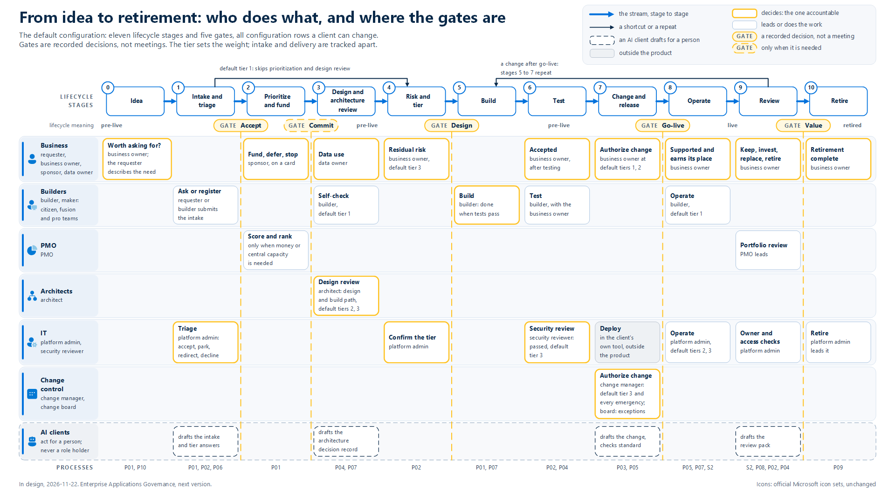

# Processes

**Status: in design.** Nothing on these pages is released or deployed. Enterprise Applications Governance (interim name) is designed to run in your own Azure subscription. This folder describes the design only.

This folder holds the eleven processes that carry an application from idea to retirement, one file per process. Each process has a number, P01 to P11, so the pages can point to each other.

| # | Process | Starts when |
|---|---|---|
| P01 | [Intake and triage](p01-intake-and-triage.md) | A person or their AI client asks for something, or registers an app that is already built |
| P02 | [Tier assessment and required approvals](p02-tier-assessment.md) | Tier answers are given or change |
| P03 | [Change management](p03-change-management.md) | A change is ready, urgent, or found after the fact |
| P04 | [Architecture review](p04-architecture-review.md) | A configured review trigger fires |
| P05 | [Deployment record](p05-deployment-record.md) | A pipeline step, an AI client or a person reports a deployment |
| P06 | [Gap check and claim](p06-gap-check-and-claim.md) | An admin asks "what is running that nobody registered?" |
| P07 | [Documentation tracking](p07-documentation-tracking.md) | A document becomes required, goes stale, or an owner records a link |
| P08 | [Owner leaves](p08-owner-leaves.md) | A leave is announced, or a signal from Entra or Agent 365 is found |
| P09 | [Retirement](p09-retirement.md) | A portfolio decision says retire, or a component vanished |
| P10 | [AI draft and human accept](p10-ai-draft-and-human-accept.md) | An AI client creates or changes a record |
| P11 | [Configuration change](p11-configuration-change.md) | An admin asks for a rule to change |

## How to read a process page

Every page has the same parts:

- **Trigger:** what starts it.
- **Who does what:** the roles in the default configuration. Every role, and every row of the table, is configuration that each organization can change.
- **Steps:** what happens, in order.
- **What is recorded:** the records the process creates or changes.
- **Approvals:** the decisions that need a person's yes. People answer on approval cards in Outlook or Teams. AI never approves.
- **What an organization can configure.**
- **Designed MCP tools:** the tools an AI client such as Claude Code would call. Names may still change.
- **Microsoft tools linked, never rebuilt.**
- **Where it runs on Azure (in design).**
- **Microsoft sources:** every Microsoft fact on the page, with its Microsoft Learn link and the date it was checked.

Steps and tables are written in the present tense so they are easy to read. They describe the design, not software that exists. Examples use fictional people and apps.

In the "Who does what" tables, "Decides" is the one person or role who answers for the outcome. There is always exactly one. "Asked first" gives input before the decision. "Told after" is informed. "AI client" shows what an AI may do for a person: draft, propose or check. It never decides.

## The value stream, from idea to retirement

The default configuration is designed to ship eleven lifecycle stages and five gates. Stages, gates and what each gate needs are configuration rows. An organization can rename them, add to them or remove them.

| # | Stage | Leads (default) | Decides (default) | Processes | Gate after |
|---|---|---|---|---|---|
| 0 | Idea | Requester or builder | Business owner: worth asking for | [P01](p01-intake-and-triage.md), [P10](p10-ai-draft-and-human-accept.md) | |
| 1 | Intake and triage | Platform admin | Platform admin: accept, park, redirect or decline | [P01](p01-intake-and-triage.md), [P02](p02-tier-assessment.md), [P06](p06-gap-check-and-claim.md) | **Accept** |
| 2 | Prioritize and fund | PMO | Sponsor: fund, defer or stop | [P01](p01-intake-and-triage.md) | **Commit** (only when money or central capacity is needed) |
| 3 | Design and architecture review | Architect (default tiers 2 and 3); builder self-check (default tier 1) | Architect: design and build path. Data owner: data use | [P04](p04-architecture-review.md), [P07](p07-documentation-tracking.md) | |
| 4 | Risk and tier | Platform admin | Platform admin: the tier. Business owner: residual risk at default tier 3 | [P02](p02-tier-assessment.md) | **Design** (after stages 3 and 4) |
| 5 | Build | Builder | Builder: done when tests pass | [P01](p01-intake-and-triage.md) (delivery links), [P07](p07-documentation-tracking.md) | |
| 6 | Test | Builder with the business owner | Business owner: accepted. Security reviewer: passed (default tier 3) | [P02](p02-tier-assessment.md), [P04](p04-architecture-review.md) | |
| 7 | Change and release | Platform admin | Business owner (default tiers 1 and 2); change manager (default tier 3 and every emergency) | [P03](p03-change-management.md), [P05](p05-deployment-record.md) | **Go-live** (after stages 6 and 7) |
| 8 | Operate | Platform admin (default tiers 2 and 3); builder (default tier 1) | Business owner: supported and earns its place | [P05](p05-deployment-record.md), [P07](p07-documentation-tracking.md), [S2](#reminders-escalation-and-notifications) | |
| 9 | Review | PMO (portfolio); platform admin (owner and access checks) | Business owner: keep, invest, replace or retire | [S2](#reminders-escalation-and-notifications), [P08](p08-owner-leaves.md), [P02](p02-tier-assessment.md), [P04](p04-architecture-review.md) | **Value** |
| 10 | Retire | Platform admin | Business owner: retirement complete | [P09](p09-retirement.md) | |

Microsoft's agent lifecycle (Intake, Triage, Build, Deploy, Monitor, Improve, Retire) is the closest official shape. The design adds prioritization, design review, change control and portfolio review.

### The five gates

A gate is a recorded decision, not a meeting. A gate decision can be accepted only when every requirement of that gate holds: a decision accepted, a document current, or a review done. The rules engine checks this when the acceptance is written, whoever writes it.

| Gate | After | What it settles in the default configuration |
|---|---|---|
| **Accept** | Stage 1 | The request is accepted into the portfolio, parked, redirected to an existing app, or declined |
| **Commit** | Stage 2 | Money or central capacity is committed. It applies only when the request needs them |
| **Design** | Stages 3 and 4 | The design, the data use and the tier are agreed |
| **Go-live** | Stages 6 and 7 | The app was accepted after testing, its change is authorized, a production deployment succeeded, and required documents and reviews are done |
| **Value** | Stage 9 | The business owner decides to keep, invest, replace or retire |

### Three rules shape the stream

1. **The tier sets the weight.** In the default configuration, a default tier 1 app skips prioritization and design review, and its business owner authorizes its changes. A default tier 3 app gets a design review, a security review and the change manager. The engine reads each tier's rules. It never branches on a tier number.
2. **Intake and delivery are tracked apart.** An accepted idea can still be in design. Acceptance is not a release gate. Microsoft's agent guidance says the same: "Track the review decision and build progress separately."
3. **Stages 5 to 7 repeat for every change after go-live.** A change goes back to stage 3 only when it crosses a design trigger ([P04](p04-architecture-review.md)), and to stage 4 when it could change the tier ([P02](p02-tier-assessment.md)).

**The maker's path.** A builder is designed to register an app as soon as anyone else uses it. When the app grows (a wider audience, shared or restricted data, a team that depends on it, or the builder leaves), it graduates. Graduation is a tier decision ([P02](p02-tier-assessment.md)) plus an ownership decision with a new technical owner and deputy ([P08](p08-owner-leaves.md)). Microsoft's support guidance also asks organizations to consider a graduation path.

## Seven rules every process obeys

1. **Configuration, never fixed values.** Who decides, who approves, which tier needs what, which documents and which reviews are all configuration rows. The engine does keep a short list of fixed meanings, such as "this status is final" or "this approver is a person", while every label stays configurable. Whether that short list is acceptable is an open design question.
2. **AI never approves.** AI clients draft, check and propose. Only a person answering an approval card can approve. The data enforces it.
3. **Roles come only from Microsoft Entra groups.** A process asks for a role. The engine resolves it to an Entra group, or to a named owner of the application. Pipelines and the approval flows are not people. Each holds one narrow workload role through a recorded grant that expires. People never get one, and AI agents never get one.
4. **Links, not copies.** For anything another tool owns, a process stores an ID, a link, a label and a "last seen" date.
5. **The product writes only its own records.** It never writes wiki pages, work items, pipelines, Entra settings or Microsoft admin settings. People's own AI tools do that work outside the product, and the product records the link.
6. **Decisions are append-only.** A process never edits an accepted decision. It records a new decision that supersedes the old one.
7. **Every write says who did it.** Each record shows the kind of actor, the person or workload, on whose behalf, through which client app, and under which configuration version.

## Three shared parts

Every process uses three shared parts. They are described once here. The value stream diagram calls them S1 (approval cards), S2 (reminders, escalation and notifications) and S3 (the engine write path).

### Approval cards

Every process that needs a person's yes is designed to use this one path.

1. **Find the rule.** The engine finds the approval rules for the decision type. The single most specific rule wins (for example, a rule for tier 3 emergencies beats a general emergency rule). When no rule matches, the card goes to the role that answers for that decision type.
2. **Find the approvers.** For an owner role, the current named owners of the application. For a product role, the members of the bound Entra group, read live from Entra.
3. **Create pending approval records.** One per required answer, never fewer than one, each with an expiry date.
4. **Send the card.** A small group of Power Automate approval flows, called the approval runner, sends one approval per rule. The mode comes from the rule: everyone must approve, first to respond, or sequential.
5. **Wait.** People answer in Outlook, Teams or the Power Automate action center. Microsoft's known issues page says an approval flow can wait for 28 days, then that flow fails. Longer waits use a timer that restarts or escalates the card.
6. **Write the answer.** Only the approval runner may write an answer. Its identity holds the one workload role that can do it. It writes the outcome, the approver, the time, the typed reason and the channel.
7. **Count it.** An answer counts only when all of these hold: it is an approval; the approver is a person signed in as a user; the approver holds the required role when they answer; and the separation rules allow it (for example, whether people may approve their own change).
8. **Settle the decision.** When every required answer is in, the engine moves the decision to Accepted and checks the gate requirements again. A rejection moves it to Rejected.
9. **Time out.** At the expiry date the engine marks the approval expired, cancels the card, and reminds or escalates to the deputy.

**What protects "AI never approves".**

| Rule | How it is designed to hold |
|---|---|
| No approve tool | No MCP tool or API endpoint approves, rejects or accepts a decision |
| Only the runner writes answers | The API lets only the approval runner's workload role write an answer, and refuses any other writer, including the approver's own AI client |
| Only a person counts | An AI step in an organization's own approval flow is recorded as a recommendation only and never counts |
| No decision without a person | A decision type with no rule still goes on a card to the role that answers for it. The one exception is a short locked list (see below) |
| Reassignment | An approver can reassign a request in Power Automate. The engine counts the new responder only if they hold the required role |
| Sequential steps | The engine checks that a sequential card never repeats an approver. Microsoft does not allow the same approver on two steps either |

**The locked list.** The design lets the engine accept a decision with no card only for a short list of decision types that a client cannot extend by configuration. The list in the current design: intake at the lowest tier, and standard changes whose model a person approved once. Whether this list should exist at all is an open design question.

**Card hygiene.** Microsoft's known issues page says that when an approver answers by email or in the action center, the Teams card does not update. So the default configuration sends each rule's card on one channel, not both.

**What approvers need.** Microsoft's licensing FAQ says: "Users who respond to approval requests don't need a Premium license." Approvers still need the Power Automate rights that Microsoft lists for answering approvals.

### Reminders, escalation and notifications

1. **Daily refresh.** Once a day the engine moves documents from current to stale when their date passes, opens reviews that have come due, expires old approvals, and lists claims that have waited too long.
2. **Remind.** For each due item, the reminder rule for its kind (review, document, approval or claim) sets when the first reminder goes out and how often it repeats.
3. **Escalate.** After a set number of days, the reminder goes to the deputy. With no deputy, it goes to the role that answers for that decision type.
4. **Notify flags.** When a deployment is flagged ([P05](p05-deployment-record.md)) and the gate level says to notify, a message goes to the business owner, the technical owner and the change manager by default.
5. **Record.** Each reminder and escalation is written to the audit log, so "who was told, and when" can be shown.

Each reminder carries the item and the reminder number, so a rerun never sends twice.

### The engine write path

Every process writes through the same path, whoever calls: the web app, an MCP client, a pipeline step or an import.

| # | Step | What the engine is designed to do |
|---|---|---|
| 1 | Identify the caller | Read who is calling and, when an AI client or a pipeline acts for a person, that person. Record the client app |
| 2 | Name the kind of actor | Person, AI client for a person, pipeline, approval runner, or engine. Rows written by an AI client are marked AI-created |
| 3 | Check the role | The caller must hold a product role that allows this write: through a bound Entra group, as a named owner of the application, or through a workload grant |
| 4 | Check the configuration | Keys exist, status changes are allowed, required fields are there, and gate requirements hold. A missing rule is a broken configuration: the engine refuses and says which rule is missing. It never guesses |
| 5 | Guard protected fields | Only the approval runner writes answers. Live configuration changes only when a new version is activated ([P11](p11-configuration-change.md)). Accepted decisions, approval records and audit entries are never edited |
| 6 | Apply AI defaults | A record an AI client creates starts as Draft, and a decision starts as Proposed ([P10](p10-ai-draft-and-human-accept.md)) |
| 7 | Stamp | The configuration version, who performed it, the time, and a stamp that the engine checked it |
| 8 | Derive | Flags, due dates and stale dates. A missing document is worked out when read, never stored |
| 9 | Audit and continue | Write an audit entry, and pass on any event a process needs next, such as a card to send |

## Where it runs on Azure (in design)

| Part | Designed to run on |
|---|---|
| API, MCP server and rules engine | One Azure Functions app on the Flex Consumption plan. Azure Container Apps is the fallback if Functions cannot carry the sign-in the design needs |
| Data store | Azure SQL Database. Append-only and frozen records (decisions, approval records, deployment records, configuration versions, audit entries) are designed as ledger tables |
| Database access | The API connects with its managed identity and passes the signed-in person's ID in the session context, so row-level security applies to that person |
| Sign-in and roles | Microsoft Entra ID. Each product role is an app role assigned to an Entra group |
| Screens | A web app built with React and Fluent UI, in the organization's own subscription |
| Approval cards | Power Automate approval flows (the approval runner) in one Power Platform environment kept for approvals. The API starts them over HTTP, and only the API's identity may start them. The runner writes answers back through the API with its own workload role |
| Timers | Timer-triggered functions for the daily refresh. Durable Functions for long waits, racing a timer against the person's answer |
| Events between steps | An outbox row plus an Azure Service Bus queue message, picked up by a function |
| Live reads as an admin | The gap check ([P06](p06-gap-check-and-claim.md)) and the owner check ([P08](p08-owner-leaves.md)) run in the MCP server with the admin's own delegated sign-in |
| Pipeline record step | An HTTPS call to the API with a token from workload identity federation. No stored secret |
| Packaging | A template that an organization deploys in its own Azure subscription |

**Approvals still need one Power Platform environment.** Microsoft says: "When you create approval flows, they're saved in Dataverse." So the design keeps one Power Platform environment just for the approval flows. It holds the approvals' titles and details, not the product's records.

**The runner's license.** The working design puts the approval flows in one solution and one flow group under one Power Automate Process license. Microsoft says a Process license "lets it use premium and custom connectors, no matter what license the owning or triggering user has", and that a flow group lets up to 25 solution-aware cloud flows share one Process license. Where a security review asks for token-level evidence of who approved, the design offers the product's own approval page instead.

## Diagrams

| Diagram | Shows |
|---|---|
| [s2-process-1-value-stream.png](../img/s2-process-1-value-stream.png) | Eleven stages, five gates, who leads and who decides |
| [s2-process-2-intake-tier.png](../img/s2-process-2-intake-tier.png) | Intake, triage and the tier ([P01](p01-intake-and-triage.md) and [P02](p02-tier-assessment.md)) |
| [s2-process-3-change.png](../img/s2-process-3-change.png) | Standard, normal and emergency changes, built in or linked ([P03](p03-change-management.md)) |
| [s2-process-4-deploy-ai.png](../img/s2-process-4-deploy-ai.png) | Deployment records and flags, and who accepts an AI draft ([P05](p05-deployment-record.md) and [P10](p10-ai-draft-and-human-accept.md)) |

## Open design questions

These are still open. Each page marks the places they touch.

- **A short list of fixed engine meanings.** Is a short list of fixed meanings (such as "this status is final") acceptable, with every label still configurable?
- **The locked list.** May the engine ever accept a decision without a person's card? The current design allows it only for intake at the lowest tier and for standard changes.
- **Which act counts as a person's for AI drafts that are not decisions.** For example, registering an app or marking a document current. See [P10](p10-ai-draft-and-human-accept.md).
- **Accepting a configuration change.** Does the admin who asked for a change accept the exact change on a card? See [P11](p11-configuration-change.md).
- **AI-only code approvals.** Does a pull request approved only by an AI ever count? See [P05](p05-deployment-record.md).
- **Workload grants.** May each pipeline's identity, and the approval runner, hold its workload role directly, as a recorded grant that expires? See [P05](p05-deployment-record.md).
- **The change gate.** How strongly the product acts before a deployment: record only, flag, advise or enforce. See [P03](p03-change-management.md).

## Microsoft sources

All checked on Microsoft Learn on 2026-11-22.

- Microsoft's agent lifecycle has the stages Intake, Triage, Build, Deploy, Monitor, Improve and Retire, and says to track the intake decision separately from delivery progress. https://learn.microsoft.com/agents/center-of-excellence/agent-lifecycle
- "Track the review decision and build progress separately." https://learn.microsoft.com/agents/center-of-excellence/agent-front-door
- "When defining support models, consider a graduation path." https://learn.microsoft.com/power-platform/guidance/adoption/support-strategy-solutions#define-tiers-of-applications
- Approvers "can respond directly from an Outlook email, a Microsoft Teams adaptive card, or the Power Automate action center if they have a Power Automate license or an Office 365 or a Dynamics 365 license with built-in Power Automate capabilities." "When you create approval flows, they're saved in Dataverse." The approval types include everyone must approve, first to respond, and sequential approval. https://learn.microsoft.com/power-automate/get-started-approvals
- "Users who respond to approval requests don't need a Premium license." "A flow group lets up to 25 solution-aware cloud flows share one Process license." https://learn.microsoft.com/power-platform/admin/power-automate-licensing/faqs
- A Power Automate Process license "lets it use premium and custom connectors, no matter what license the owning or triggering user has. Flows must be in a solution for a Process license to be assigned." https://learn.microsoft.com/power-platform/admin/power-automate-licensing/types
- "An approval flow can wait for 28 days. If the wait time exceeds 28 days, that flow fails." "If the approver responds through the email notification or through the approval action center, the card in Microsoft Teams doesn't auto-update." https://learn.microsoft.com/power-automate/approvals-known-issues
- An approver can reassign an approval request. "If you are the requester, you cannot reassign the approval request." https://learn.microsoft.com/power-automate/approvals-howto
- "You can't assign the same approver to different steps of your approval." https://learn.microsoft.com/power-automate/set-up-sequential-approvals
- The "When an HTTP request is received" trigger can be limited to "Specific users in my tenant", and "You can also enter object IDs of service principal users if you intend to use this flow to be triggered only by SPN (service principal name) users." https://learn.microsoft.com/power-automate/oauth-authentication
- "Flex Consumption is a Linux-based Azure Functions hosting plan that builds on the Consumption pay for what you use serverless billing model." "Flex Consumption is the recommended serverless hosting plan for Azure Functions." https://learn.microsoft.com/azure/azure-functions/flex-consumption-plan
- In the human interaction pattern, "The orchestrator starts a durable timer and simultaneously waits for an external event from the person." https://learn.microsoft.com/azure/durable-task/common/durable-task-human-interaction
- Append-only ledger tables "block updates and deletions at the API level." "Both updatable ledger tables and append-only ledger tables provide tamper-evidence and digital forensics capabilities." https://learn.microsoft.com/sql/relational-databases/security/ledger/ledger-overview
- "Use SESSION_CONTEXT (T-SQL) for users who connect to the database through a middle-tier application where application users share the same SQL Server user account." https://learn.microsoft.com/sql/relational-databases/security/sql-server-security-best-practices#row-level-protection
- "Group-based assignment requires Microsoft Entra ID P1 or P2 edition." When a group is assigned to an application, "The assignment doesn't cascade to nested groups." https://learn.microsoft.com/entra/identity/enterprise-apps/assign-user-or-group-access-portal
- Workload identity federation lets an app registration or a user-assigned managed identity in Microsoft Entra ID "trust tokens from an external identity provider (IdP), such as GitHub or Google." https://learn.microsoft.com/entra/workload-id/workload-identity-federation

---

Microsoft, Azure, Entra, Power Automate, Power Platform, Dataverse, Outlook, Teams and Fluent are trademarks of the Microsoft group of companies. Claude Code is a product of Anthropic. Enterprise Applications Governance is not a Microsoft product and is not endorsed by Microsoft.
