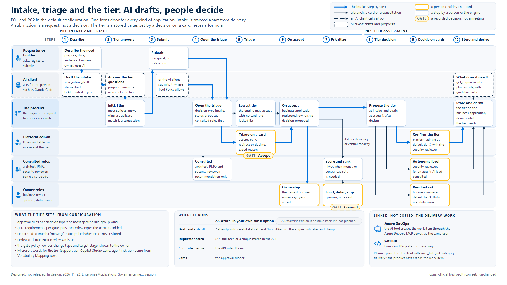

# P01 Intake and triage

**Status: built and tested; runs as a demo install with fictional data; no release yet.** This page describes the design. Demo scenarios [S-20](../../../src/docs/demo/scenarios/S-20-requester.md) and [S-03](../../../src/docs/demo/scenarios/S-03-triage-gap-check-places-leavers.md) play it on fictional data, and the [processes index](README.md) says where the built product differs, such as approvals answered on the decision page instead of on cards. Roles, steps and approvals are the default configuration, and each organization can change them.

## In short

Intake is designed as one front door for every kind of business application: new ideas, apps that are already built, agents, AI-built apps, code apps and SaaS from other vendors. It records the request, the first tier and the triage decision. It keeps the intake decision apart from delivery, so an accepted idea can still be in design.

## Trigger

- A requester or builder asks through an MCP client ("I want an app that...", "register the app I built"), or in the web app.
- A claim from the gap check that belongs to no registered application ([P06](p06-gap-check-and-claim.md)).
- An owner registers again after the app outgrows its tier (graduation).

## Who does what (default configuration)

| Step or decision | Does the work | Decides | Asked first | Told after | AI client |
|---|---|---|---|---|---|
| Submit an idea, or register an app already built | Requester or builder | Business owner | | Platform admin, PMO, architect | Drafts the intake |
| Triage: accept, park, redirect to reuse, or decline | Platform admin | Platform admin | Business owner, security reviewer, PMO, architect | Requester, builder | Drafts a summary |
| Set the first tier from the plain questions | Requester or builder | Platform admin | Business owner, security reviewer | | Proposes answers |
| Score and rank demand that needs central capacity | PMO | PMO | Business owner, platform admin, architect | Builder | Drafts the scoring |
| Fund, defer or stop | PMO | Sponsor | Platform admin, architect | Builder | none |
| Choose the build path | Platform admin | Architect | Builder, business owner, PMO | | Drafts options |

## Steps

1. **Draft.** The person describes the need. Their AI client saves an intake request as a draft, marked AI-created. Only governance questions are asked: purpose, business owner, data, audience, whether it uses AI, and the proposed kind of app.
2. **Answer the tier questions.** The AI client fetches the tier questions for that kind of app and records the answers as a draft tier assessment. [P02](p02-tier-assessment.md) works out the first tier.
3. **Check for duplicates and reuse.** The product searches the register by name, purpose and kind. A match is shown as a suggestion, never as a decision.
4. **Submit.** The requester submits. A submission is a request, not a decision. The AI client may submit for the person where the tool policy allows it, and the shipped default allows it for intakes. Which act counts as a person's here is an open design question ([P10](p10-ai-draft-and-human-accept.md)).
5. **Open the triage decision.** The engine opens an intake decision with the status Proposed and the outcomes accept, park, redirect and decline. It asks the consulted roles for input: the architect for reuse, the PMO for demand and the security reviewer for first risk. Each is asked with a consultation request. A consultation answer is recorded as a recommendation only and never counts as an approval.
6. **Decide.** The platform admin answers the triage request with a typed reason, on the decision page by default ([approvals](README.md#approval-cards)). The current design has one exception: intake at the lowest tier is on the locked list, so the engine may accept it with no person's answer, and the record links the configuration decision that set that rule. Whether this exception should exist is an open design question. An organization that wants a person's answer here gives intake an approval rule.
7. **Act on the outcome.**
   - **Accept:** the engine registers the business application, or links the existing one, and proposes an ownership decision for the named business owner. Nobody becomes an owner without their own yes, given on the decision page by default.
   - **Park:** the PMO sets a horizon (now, next or later). The intake stays visible to the requester.
   - **Redirect:** the duplicate is confirmed, and the requester is pointed to the existing app and its owner.
   - **Decline:** the reason is visible to the requester.
8. **Prioritize when needed.** If an answer says the request needs money or central capacity, the engine opens a priority decision. The PMO records a score, a horizon, a size band and the expected benefit. The sponsor decides, on the decision page by default. The Commit gate follows.
9. **Link the delivery work.** The requester's own AI tool creates the work item in Azure DevOps through the Azure DevOps MCP Server, as the same person. It then records the link in the product. Planner plans and GitHub Projects are linked the same way. The product never reads the work item or the plan.

## What is recorded

| Record | What happens |
|---|---|
| Intake request | Created as a draft, submitted, then completed, rejected, withdrawn or canceled |
| Tier assessment | Created with the answers and the computed tier |
| Decision | Intake; priority when needed; ownership on accept |
| Approval record | One per required answer |
| Business application | Created, or linked, on accept |
| Owner assignment | Created after the ownership decision is accepted |
| Person reference | The Entra ID and a display label for the requester, owners and deciders, created on first sight |
| Delivery link | Added by the requester's AI tool or a person |

## Approvals (people only)

| Decision | Approver in the default configuration | Approval mode | Notes |
|---|---|---|---|
| Intake | Platform admin | First to respond | Typed reason required. Lowest-tier intake is on the locked list (open design question) |
| Priority | Sponsor | First to respond | Only when the request needs money or central capacity |
| Ownership | The named business owner | Everyone must approve | The named person must accept |

## What an organization can configure

- The intake questions, their answers, and what each answer triggers.
- The kinds of application.
- The intake and priority outcomes, and the lifecycle stage each outcome leads to.
- Who triages, who is consulted, and who funds.
- What the Accept and Commit gates require.
- The horizon and size band lists.
- Whether an AI client may submit an intake for a person.
- Who can read intake requests. The default is "own": the requester, the PMO, the platform admin and the architect.

## MCP tools

Every tool runs as the signed-in person.

| Tool | What it does |
|---|---|
| `save_intake_draft` | Creates or updates a draft intake |
| `get_tier_questions` | Returns the tier questions for a kind of app |
| `answer_tier_questions` | Records the tier answers as a draft assessment |
| `check_duplicates` | Searches the register for duplicates and reuse |
| `submit_record` | Submits a draft intake |
| `get_my_queue` | "What needs me": intakes to triage, approvals waiting |
| `save_link` | Records a link to a work item, plan, project or repository |

## Microsoft tools linked, never rebuilt

- [Azure Boards](https://learn.microsoft.com/azure/devops/boards/get-started/what-is-azure-boards) work items, created by the person's own AI tool through the [Azure DevOps MCP Server](https://learn.microsoft.com/azure/devops/mcp-server/remote-mcp-server).
- Planner plans and GitHub Projects, as links only.
- Microsoft's [agent front door](https://learn.microsoft.com/agents/center-of-excellence/agent-front-door) guidance, as a reference for the intake design.

## Where it runs on Azure (in design)

| Concern | Designed to run on |
|---|---|
| Draft and submit | API endpoints in the one Azure Functions app, with the same names as the tools. The rules engine validates and stamps each write |
| Duplicate search | A full-text search or a simple match in Azure SQL Database. The exact method is still a design point |
| Triage and other notices and cards | The approval runner ([approval cards](README.md#approval-cards)) |

## Example (fictional people and apps)

Priya Castell, a maker in field operations, asks Claude Code to submit an intake for a field inspections app. In the design, Claude Code would check for duplicates and find an older Inspection Scheduler app. It would save the intake as a draft marked AI-created, then submit it for her. One triage request would wait for a platform admin. Nothing would be accepted until a person answers.

## Microsoft sources

All checked on Microsoft Learn on 2026-11-22.

- "Track the review decision and build progress separately." "Approval doesn't mean it's deployed or ready for production." Microsoft's front door guidance also says the front door agent recommends a route and does not approve the work, and "Designated reviewers make approval decisions, and every build must meet the release requirements for its risk tier." https://learn.microsoft.com/agents/center-of-excellence/agent-front-door
- The remote Azure DevOps MCP Server has a `wit_work_item_write` tool whose `create` action is described as "Create a new work item". https://learn.microsoft.com/azure/devops/mcp-server/remote-mcp-server

Previous: [processes index](README.md). Next: [P02 Tier assessment and required approvals](p02-tier-assessment.md).
