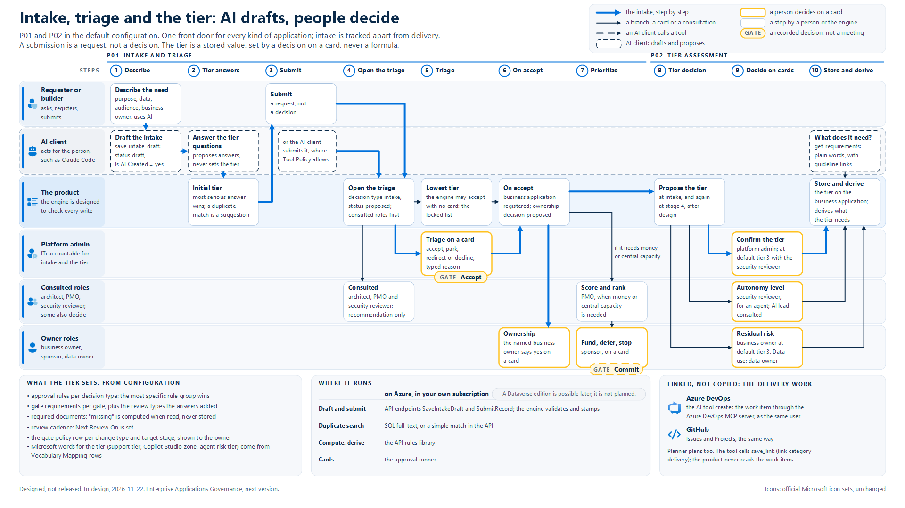

# P02 Tier assessment and required approvals

**Status: built and tested; runs as a demo install with fictional data; no release yet.** This page describes the design. Demo scenarios [S-02](../../../src/docs/demo/scenarios/S-02-ai-build-loop.md) and [S-08](../../../src/docs/demo/scenarios/S-08-agents.md) play it on fictional data, and the [processes index](README.md) says where the built product differs, such as approvals answered on the decision page instead of on cards. Roles, steps and approvals are the default configuration, and each organization can change them.

## In short

This process is designed to turn plain answers into a tier that a person decides. From that tier it is designed to work out everything the application now needs: who approves each kind of decision, what each gate requires, which documents are required, how often reviews come due, and how strongly deployments are checked.

The product is designed to ship three tiers by default. An organization can set any number. Each tier is a configuration record, and the engine never branches on a tier number.

## Trigger

- An intake is submitted: the first tier, at stage 1 ([P01](p01-intake-and-triage.md)).
- Design is done: the confirmed tier, at stage 4.
- An answer changes, a change request could change the tier ([P03](p03-change-management.md)), a tier check review comes due, or the app outgrows its tier.

## Who does what (default configuration)

| Step or decision | Does the work | Decides | Asked first | Told after | AI client |
|---|---|---|---|---|---|
| Confirm an application's tier | Builder | Platform admin | Business owner, data owner, security reviewer, architect | Change manager | Proposes answers |
| Accept residual risk (default tier 3) | | Business owner | Data owner, platform admin, security reviewer, architect | Builder, change manager | none |
| Approve a data use | Platform admin | Data owner | Security reviewer, architect | Builder, business owner | none |
| Approve restricted data reaching an AI model | Platform admin | Data owner, and the security reviewer must agree | Architect, AI lead | Builder, business owner | none |
| Set an agent's autonomy level | Platform admin | Security reviewer | Business owner, data owner, architect, AI lead | Builder | none |

The restricted-data row needs two yeses. Only one role can answer for a decision, so the default configuration sends one approval request to two approver roles with the mode "everyone must approve". The AI lead is consulted on autonomy levels. An organization can rename the AI lead role, map it to another group, or drop it.

## Steps

1. **Answer.** The person, or their AI client, records the answers. The AI may propose answers from the intake text. It never sets the tier.
2. **Compute.** The engine maps each answer to the tier it implies and takes the most serious one. It also collects what each answer triggers, for example "add a security review", "add an architecture review" or "add a responsible AI review".
3. **Explain.** The product says which answer drove the result, and can show the engine's rule trace. It also shows the Microsoft words for the tier: the Power Platform support tier, the Copilot Studio zone and the agent risk tier. That mapping is the product's own default configuration. No Microsoft page joins the three.
4. **Propose the tier decision.** The engine opens a tier decision with the status Proposed and the computed tier as its outcome. A person may raise the tier on the same decision. Lowering it below the computed tier needs a typed reason and the full set of approvals.
5. **Approve.** Approval requests go out under the approval rules for tier decisions at this scope. At the highest default tier, the engine also opens a residual risk decision for the business owner.
6. **Store.** On acceptance, the engine stores the tier on the business application. The tier is a stored value set by a decision, never a formula.
7. **Work out what the tier needs.** From configuration, for this application, the engine works out:
   - the approval rule that now applies to each kind of decision and stage (the most specific rule wins);
   - what each gate requires, including the reviews the answers added;
   - the required documents. A missing document is worked out when read. Nothing is stored until a link is recorded ([P07](p07-documentation-tracking.md));
   - the review cadence, which sets the next review date;
   - the gate level for each kind of change and target stage, shown to the owner ([P05](p05-deployment-record.md)).
8. **Agents.** For an agent, the engine opens an autonomy level decision. The agreed level is stored on the application. Enforcing it stays in Microsoft's tools, such as Copilot Studio, Agent 365 and Entra.
9. **Answer "what does my tier need?"** The product returns the list from step 7 in plain words, with links to the guidelines.

## What is recorded

| Record | What happens |
|---|---|
| Tier assessment | The answers and the computed tier. The deciding tier decision is linked on acceptance |
| Decision | Tier; residual risk; data use; autonomy level |
| Approval record | One per required answer |
| Business application | The tier, the deciding decision, the next review date and the agreed autonomy level |
| Document link | None created here. New requirements show as missing until a link is recorded |
| Review | Due reviews scheduled from the cadence |

## Approvals (people only)

| Decision | Default tiers 1 and 2 | Default tier 3 |
|---|---|---|
| Tier | Platform admin | Platform admin and security reviewer (everyone must approve) |
| Residual risk | Not required | Business owner |
| Data use | Data owner | Data owner, plus the security reviewer for restricted data reaching an AI model |
| Autonomy level | Security reviewer (AI lead consulted) | Security reviewer (AI lead consulted) |

## What an organization can configure

- The tiers, their order and their labels: three, five or more.
- The tier questions, their answers, the tier each answer implies, and what each answer triggers.
- The mapping from each tier to Microsoft's vocabularies.
- What each gate requires, per tier.
- The required documents per tier and kind of app.
- The review types and how often they come due per tier.
- Who decides and who approves, per tier.
- The gate level per tier, kind of change and target stage.
- A starting preset. The design includes a preset that lines its tiers up with Microsoft's three agent risk tiers, re-checked against Microsoft's guidance with each release.

## MCP tools

Every tool runs as the signed-in person.

| Tool | What it does |
|---|---|
| `get_tier_questions` | Returns the tier questions for a kind of app |
| `answer_tier_questions` | Records the answers and says which answer drove the result |
| `explain_rules` | Returns the engine's rule trace |
| `save_decision_proposal` | Opens a tier decision as Proposed. It cannot accept it |
| `get_requirements` | "What does my tier need?" in plain words |
| `get_configuration` | Returns configuration, including the Microsoft vocabulary for a tier |

## Microsoft tools linked, never rebuilt

- The three Microsoft vocabularies, used as labels: Microsoft's [agent risk tiers](https://learn.microsoft.com/agents/center-of-excellence/govern-agents-risk), the [Copilot Studio governance zones](https://learn.microsoft.com/microsoft-copilot-studio/guidance/sec-gov-phase2) and the [Power Platform application support tiers](https://learn.microsoft.com/power-platform/guidance/adoption/support-strategy-solutions#define-tiers-of-applications).
- Managed Environments and environment groups, linked from the application's deployment targets. The product never sets them.
- Copilot Studio, Agent 365 and Entra, which enforce an agent's autonomy. The product records the agreed level and links to them.

## Where it runs on Azure (in design)

| Concern | Designed to run on |
|---|---|
| Compute the tier and work out what it needs | The rules engine inside the one Azure Functions app, on each answer and on each acceptance |
| Missing documents | Worked out by the rules engine when read. No row is stored |
| Tier notices and cards | The approval runner ([approval cards](README.md#approval-cards)) |
| The stored tier | A column on the business application in Azure SQL Database. Tier decisions and approval records are ledger tables |

## Example (fictional people and apps)

Priya Castell answers four tier questions with Claude Code for a field inspections app. In the design, the engine would compute tier 2 as a suggestion only. A platform admin would confirm the tier on the decision page. Only then would the app carry tier 2, with its approvals, documents and review dates.

## Microsoft sources

All checked on Microsoft Learn on 2026-11-22.

- "Match the depth of governance to the risk each agent poses to enable low-risk work quickly, and reserve heavier controls for agents that can cause real harm." The guidance uses three risk tiers. Tier 3 controls include "A security review and a responsible AI assessment before release" and "A decision-rights framework that sets what the agent may decide alone and what needs a human". It also says: "Treat the recommendation as an initial assessment, not approval or a substitute for release controls." https://learn.microsoft.com/agents/center-of-excellence/govern-agents-risk
- "You can govern agent creation by separating it into three zones". https://learn.microsoft.com/microsoft-copilot-studio/guidance/sec-gov-phase2
- "As you define your support process and escalation path, it's important to categorize solutions based on criticality." The tiers table has three columns: Productivity, Important and Critical. https://learn.microsoft.com/power-platform/guidance/adoption/support-strategy-solutions#define-tiers-of-applications

Previous: [P01 Intake and triage](p01-intake-and-triage.md). Next: [P03 Change management](p03-change-management.md).
