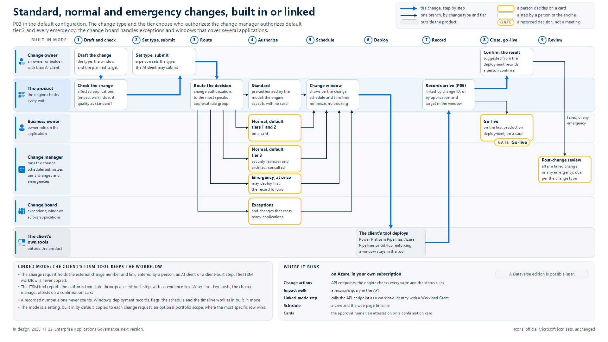

# P03 Change management

**Status: built and tested; runs as a demo install with fictional data; no release yet.** This page describes the design. Demo scenario [S-05](../../../src/docs/demo/scenarios/S-05-changes-and-deployments.md) plays it on fictional data, and the [processes index](README.md) says where the built product differs, such as approvals answered on the decision page instead of on cards. Roles, steps and approvals are the default configuration, and each organization can change them.

## In short

This process is designed to plan, authorize, schedule and close every change to a business application, across every tool that deploys it. It has two modes:

- **Built in (the default).** The product runs change requests, change types, approvals, change windows, the schedule and the result.
- **Linked.** An organization that already has a change tool keeps it. The product stores that tool's change number and link, and does not copy its workflow.

The product never deploys anything. The organization's own tools deploy, and deployments arrive as records ([P05](p05-deployment-record.md)).

## Trigger

- A change is ready: an owner, a builder or their AI client starts a change request.
- An emergency: a service is down or there is a security exposure.
- A deployment record arrives with no change request, where the gate policy expects one ([P05](p05-deployment-record.md)).
- A retirement needs its removal scheduled ([P09](p09-retirement.md)).

## Mode

Each change request copies the mode (built in or linked) from a setting when it is created. The setting can differ by portfolio. The most specific setting wins.

## Who does what (default configuration)

| Step or decision | Does the work | Decides | Asked first | Told after | AI client |
|---|---|---|---|---|---|
| Keep the standard change models per tier | Platform admin | Change manager | Security reviewer, architect | Builder, business owner | none |
| Authorize a normal change (default tiers 1 and 2) | Platform admin | Business owner | Data owner | Builder, change manager | Drafts the change |
| Authorize a normal change (default tier 3) | Platform admin | Change manager | Business owner, data owner, security reviewer, architect, change board (exceptions and changes across apps) | Builder, PMO | Drafts the change |
| Approve an emergency change | Platform admin | Change manager | Business owner, security reviewer | Builder, PMO | none |
| Keep the change schedule and windows | Platform admin | Change manager | Business owner | Builder, PMO | none |
| Deploy, in the organization's own tool | Platform admin | Platform admin | | Builder, business owner, change manager | none |
| Declare the application live (go-live) | Platform admin | Business owner | | Builder, change manager, PMO | none |
| Review after an emergency or failed change | Platform admin | Change manager | Builder, business owner, security reviewer | | Drafts the review |

The change manager authorizes default tier 3 changes and every emergency. The change board handles exceptions and windows that cover several applications. There is no separate emergency approver role.

## Steps, built-in mode

1. **Draft.** The change owner, or their AI client, drafts a change request: title, main application, proposed change type, window start and end, and planned target. The engine proposes the affected applications by walking the dependencies, and lists the owners of dependent apps for information.
2. **Classify.** The product checks whether the change qualifies as a standard change: the model is listed for this tier; the change adds no new data use, connector, permission or identity; a shared component has no dependants; and the same tested artifact is used. It answers "qualifies" or "does not qualify, because". The AI proposes. A person sets the type. Some changes always become normal: a new restricted data use, a role change for the app's own identity, a change to an agent's model or instructions, a change to a shared component with dependants, and anything that could raise the tier.
3. **Submit.** The change owner submits. The AI client may submit for the person where the tool policy allows it. Which act counts as a person's here is an open design question ([P10](p10-ai-draft-and-human-accept.md)). The change type sets whether authorization is needed, whether it may come after the deployment, and whether a review must follow.
4. **Authorize.**
   - **Standard:** the engine accepts the authorization as pre-authorized, citing the standard change model and the decision of the person who approved that model. Standard changes are on the locked list of decisions the engine may accept with no person's answer. Whether that list should exist is an open design question.
   - **Normal:** a change authorization decision goes to the approvers under the most specific approval rule for this tier and change type. By default: the business owner for default tiers 1 and 2; the change manager for default tier 3, with the security reviewer and the architect consulted; the change board for exceptions and changes that cross many applications.
   - **Emergency:** the change manager authorizes at once, on the decision page by default, under the emergency rule. Because an emergency allows authorization after the fact, the deployment may happen first and the record is completed after. The gate policy sets how long the follow-up may take. A review after the change comes due.
5. **Schedule.** The window shows on the change schedule and, read-only, on the timeline. There are no freeze tables and no booking. Enforcing a window stays in the deployment tool, for example the Azure Pipelines Business Hours check.
6. **Deploy.** The organization's own tool deploys. Deployment records arrive through [P05](p05-deployment-record.md) and link to the change by its ID, or by match (same application and target, inside the window).
7. **Go-live.** For a first production deployment, the engine proposes a go-live decision. The Go-live gate is checked when it is accepted: acceptance after testing is accepted, the change is authorized, a production deployment succeeded, and the required documents and reviews are done.
8. **Close.** The engine suggests the result (succeeded, partly succeeded, failed, rolled back or canceled) from the linked deployment records. The change owner confirms it, because completing a change is a person's act.
9. **Review.** A failed change, or any emergency, opens a review after the change, due as the change type sets.

## Steps, linked mode

1. The change request holds the external change number and link. A person, an AI client or a step the organization builds may enter them. The change tool's workflow is never copied.
2. The product does not run its own authorization. The organization's change tool reports the authorization through a step the organization builds (the same kind of step as a pipeline record step), with a link to the evidence. Where no such step exists, the change manager confirms "authorized in the external tool" through a confirmation request. A recorded change number alone never counts as authorization.
3. The missing-approval flag ([P05](p05-deployment-record.md)) treats a linked change as authorized only when that authorization is on record.
4. Windows, deployment records, flags, the schedule and the timeline work as in built-in mode.

## What is recorded

| Record | What happens |
|---|---|
| Change request | Created, submitted, completed or canceled. Holds the mode, the window, any external reference and the result |
| Affected application | Proposed by the dependency walk, confirmed by the change owner |
| Decision | Change authorization; go-live; the outcome of the review after the change |
| Approval record | One per required answer |
| Deployment record | Linked to the change ([P05](p05-deployment-record.md)) |
| Evidence link | Test results, impact lists, the organization's own release record, an authorization from the change tool |
| Review | Review after the change |

## Approvals (people only)

| Decision | Approver in the default configuration | Approval mode |
|---|---|---|
| Change authorization, normal, default tiers 1 and 2 | Business owner | First to respond |
| Change authorization, normal, default tier 3 | Change manager (security reviewer and architect consulted) | First to respond |
| Change authorization, exceptions and changes across many apps | Change board | Set by the rule |
| Change authorization, emergency | Change manager | First to respond |
| Change authorization, standard | None per change: pre-authorized by a model a person approved once (open design question) | |
| Go-live | Business owner | First to respond |
| Authorization in linked mode, with no reporting step | Change manager, through a confirmation request | First to respond |

Changing a gate policy row is itself a decision, made through [P11](p11-configuration-change.md).

## The change gate (open design question)

How strongly the product acts before a deployment is still open. The design holds five levels, set per tier, kind of change and target stage:

- **Off:** no check.
- **Record:** flags are stored. Nobody is told.
- **Flag:** flags are stored and the owners and the change manager are told the same day.
- **Advise** and **Enforce:** the same, plus a check step that the organization adds before its own deploy, published as a copy-paste sample.

Off, Record and Flag work with the product alone. Advise and Enforce need the check step and come after the gate decision. In Azure Pipelines, an administrator of the resource can bypass a check, and the bypass shows in the checks panel. The product would see such a deployment through [P05](p05-deployment-record.md) and flag it.

## What an organization can configure

- The mode: built in or linked, and per portfolio if needed.
- The change types (standard, normal and emergency by default): whether each needs authorization, whether authorization may come after, and whether a review must follow and by when.
- The standard change models and their conditions.
- Who authorizes, per tier and change type, and who is consulted.
- The separation rules, for example whether people may approve their own change.
- The gate level, how a failed check behaves, and the emergency follow-up time.
- Which dependency types count when the impact walk runs.
- What the Go-live gate requires.

## MCP tools

Every tool runs as the signed-in person.

| Tool | What it does |
|---|---|
| `save_change_request_draft` | Creates or updates a draft change. In linked mode it also takes the external change number and link |
| `check_standard_change` | Says whether the change qualifies as standard, and why |
| `get_dependency_impact` | Walks the dependencies to find affected applications |
| `submit_record` | Submits a draft change |
| `get_change_schedule` | Returns the planned changes and their windows |
| `record_change_result` | Records the result as reported. A person confirms completion |
| `get_my_queue` | "What needs me" |
| `save_link` | Records a link to the work item for the change, created by the person's own AI tool |

## Microsoft tools linked, never rebuilt

- [Power Platform Pipelines](https://learn.microsoft.com/power-platform/alm/extend-pipelines) approvals and gated extensions.
- [Azure Pipelines approvals and checks](https://learn.microsoft.com/azure/devops/pipelines/process/approvals), including Business Hours and Invoke REST API.
- GitHub environments and required reviewers.
- [Agent 365](https://learn.microsoft.com/microsoft-agent-365/admin/agent-actions) requests to publish an agent, in the Microsoft 365 admin center.
- [Azure Boards](https://learn.microsoft.com/azure/devops/boards/get-started/what-is-azure-boards) work items for the change, created by the person's own AI tool.

## Where it runs on Azure (in design)

| Concern | Designed to run on |
|---|---|
| Change actions | API endpoints in the one Azure Functions app. The rules engine enforces the status rules |
| Linked-mode authorization step | The organization's step calls the API as a workload identity that holds a recorded grant. Without a step, a confirmation request to the change manager |
| Dependency walk | A recursive query in Azure SQL Database, run by the API |
| Authorization notices and cards | The approval runner ([approval cards](README.md#approval-cards)) |
| Schedule | A view and the timeline page in the web app |
| Records | Decisions and approval records are ledger tables, so an accepted authorization cannot be edited |

## Example (fictional people and apps)

Priya Castell asks Claude Code to plan the go-live of a field inspections app to production on Thursday between 06:00 and 08:00 UTC, and send it for approval. In the design, Claude Code would draft a normal change with that window and submit it. The engine would open a change authorization decision as Proposed and AI-created. One approval request would wait for the business owner, Nadia Ferreira, on the decision page. If Priya then asked Claude Code to approve it for Nadia, it could not: no tool an AI client is served approves, and the engine records an answer only from the person the request asks, on the decision page or in a card whose answer the approval runner relays.

## Microsoft sources

All checked on Microsoft Learn on 2026-11-22.

- "Approvals and other checks aren't defined in the yaml file." The dynamic checks include Invoke REST API and Business Hours. "In case you want all deployments to your environment to happen in a specific time window only, then business hours check is the ideal solution." A check can be bypassed only by someone with the administrator permission for the resource, and "When you bypass a check, you'll see who bypassed the check in the checks panel." https://learn.microsoft.com/azure/devops/pipelines/process/approvals
- Power Platform Pipelines can be extended with gated extensions, and "Each step of a pipeline deployment triggers a real-time event at the beginning and completion of the step." https://learn.microsoft.com/power-platform/alm/extend-pipelines
- "Make sure that you define who can approve safe deployment acceleration in an emergency and the criteria that must be met for acceleration to be approved." https://learn.microsoft.com/power-platform/well-architected/operational-excellence/safe-deployments
- "Postmortems should follow all failed deployments without exception." https://learn.microsoft.com/power-platform/well-architected/operational-excellence/mitigation-strategy
- "Changes that can materially affect agent behavior should trigger re-evaluation before production deployment. Model replacements and instruction updates can change agent outputs." https://learn.microsoft.com/azure/cloud-adoption-framework/ai-agents/operational-standards

Previous: [P02 Tier assessment and required approvals](p02-tier-assessment.md). Next: [P04 Architecture review](p04-architecture-review.md).
