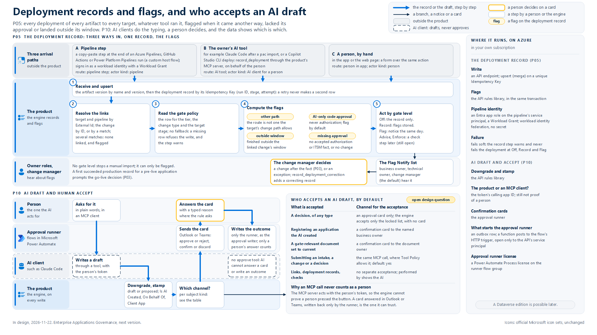

# P05 Deployment record

**Status: built and tested; runs as a demo install with fictional data; no release yet.** This page describes the design. Demo scenario [S-05](../../../src/docs/demo/scenarios/S-05-changes-and-deployments.md) plays it on fictional data, and the [processes index](README.md) says where the built product differs, such as approvals answered on the decision page instead of on cards. Roles, steps and approvals are the default configuration, and each organization can change them.

## In short

This process is designed to record every deployment of every artifact to every target, whatever tool ran it. It is designed to flag deployments that came another way, lacked their approval, or landed outside their window. By design, the product never builds, hosts or runs a pipeline. Organizations keep Power Platform Pipelines, Azure Pipelines or GitHub Actions.

## Trigger: three ways a deployment arrives

| Path | Who sends it | How |
|---|---|---|
| **A. Pipeline step** | A step at the end of the organization's own Azure Pipelines, GitHub Actions or Power Platform Pipelines run, copied from a published sample. For Power Platform Pipelines, a flow in a custom pipelines host that listens for the deployment-completed event | Calls the product's API with the pipeline's own workload identity |
| **B. AI tool** | The owner's AI tool, for example Claude Code after an import or a deploy | Records the deployment through the product's MCP server, on behalf of the person |
| **C. By hand** | A person in the web app | A form over the same action |

A pipeline is not a person. In path A, the pipeline's identity holds the deployment recorder role directly, through a recorded grant with a reason, the decision that allowed it and an expiry date. Whether pipelines may hold the role this way is an open design question.

## Who does what (default configuration)

| Step or decision | Does the work | Decides | Asked first | Told after | AI client |
|---|---|---|---|---|---|
| Record a deployment (pipeline step) | The pipeline's workload identity | Platform admin | | Technical owner, business owner, change manager | none |
| Record a deployment (AI tool or by hand) | Builder or technical owner | Platform admin | | Business owner, change manager | Records it for the person |
| Follow up a flag: open a change after the fact, or record an exception | Platform admin | Change manager | Builder, technical owner, business owner | | Drafts the follow-up |

## Steps

1. **Receive.** The sender passes: the application, the artifact name and version, the target, the route, the run link, the start and finish times, the result, the version before and after, the change request if known, the pipeline, and an idempotency key (for example, the run ID plus the stage plus the attempt). It may also pass who approved the code merge: a person, an AI only, nobody, or unknown.
2. **Store once.** The engine stores the artifact version, then the deployment record by its idempotency key. A retry never creates a second record. A run that was abandoned is recorded with the result "not deployed".
3. **Resolve the links.** The engine finds the target and the pipeline by their IDs. An unknown pipeline is created with a "not mapped" note for the platform admin. The change request is found by ID, or by match: an open change for the same application and target whose window covers the finish time. If several match, none is linked and the record is flagged for a person.
4. **Apply the gate policy.** The engine reads the gate policy row for the application's tier, the kind of change, and the target's stage, and stores the gate level it applied. A deployment with no change request uses a configured default kind of change ("normal" by default). There is no built-in fallback. If no row matches, the configuration is broken: the engine refuses the write and says so, and the record step warns without stopping the deployment. Validation of the configuration is designed to make this case impossible.
5. **Compute the flags.**
   - **Other path:** the route is not one the target's change path allows.
   - **Outside window:** the deployment finished outside the linked change's window.
   - **Missing approval:** the change has no accepted authorization (with counting approvals, or pre-authorized by a standard change model), or a linked change has no authorization on record ([P03](p03-change-management.md)), or there is no change where the policy expects one.
   - **Emergency:** an emergency may deploy first, and its authorization must follow inside the follow-up time the gate policy sets. Whether the record shows a flag during that time, or only after it runs out, is an open design question.
   - **AI-only code approval:** when the sender reports that the only code approval came from an AI, the gate policy decides whether to ignore it, flag it, or stop at Enforce. AI-only code approvals never count as authorization, and the default is to flag them. Whether such approvals should ever count is an open design question.
6. **Act by gate level.** Off: nothing beyond the record. Record: flags are stored and nobody is told. Flag: the owners and the change manager are told the same day ([reminders and notifications](README.md#reminders-escalation-and-notifications)). Advise and Enforce: the same, plus a check step before the deploy, which comes after the change gate decision ([P03](p03-change-management.md)).
7. **Follow up.** For a flagged deployment, the change manager decides: open a change request after the fact ([P03](p03-change-management.md)), or record an exception decision. A deployment record is final once written, so linking it to a new change adds a correcting record. No gate level stops a manual import. It can only be flagged.
8. **Keep facts current.** Each record updates the "last seen" date of its target and pipeline. The product's record stays as durable evidence when a pipeline tool deletes its old runs.
9. **Go-live hint.** A first succeeded production deployment for an app that is not yet live prompts the go-live decision ([P03](p03-change-management.md)).

## The record step samples

The design publishes copy-paste record steps as samples. They are designed to:

- **fail soft:** the step warns and never fails the deployment at the Off, Record and Flag levels;
- **use no stored secret:** workload identity federation only, with no client secret, personal access token or certificate;
- **send the token to one place only:** the product's own endpoint, over HTTPS, with no redirect.

## What is recorded

| Record | What happens |
|---|---|
| Artifact version | Stored once per artifact name and version |
| Deployment record | Stored once per idempotency key, with its flags, the gate level applied and any reported code approvals. Final once written. Correcting records link a change later |
| Deployment target and pipeline reference | The "last seen" date is updated |
| Evidence link | The run, and the organization's own release record |
| Change request | Gets a suggested result from its deployments |

## Approvals (people only)

None in this process. Follow-up decisions go through [the approval path](README.md#approval-cards) of [P03](p03-change-management.md).

## What an organization can configure

- The gate policy rows: the gate level per tier, kind of change and target stage; how a failed check behaves; the emergency follow-up time; and how to treat AI-only code approvals.
- The target stages, and which routes each target's change path allows.
- The deployment routes and pipeline kinds.
- The default kind of change for a deployment with no change request.
- Who is told about flags.
- The recorded grant for each pipeline identity, with its expiry.

## MCP tools

AI tools reach these through the MCP server, as the signed-in person. A pipeline step calls the API directly, not MCP.

| Tool | What it does |
|---|---|
| `record_deployment` | Records a deployment for the person, including any reported code approvals |
| `get_deployments` | Lists deployments, or only the flagged ones |
| `record_deployment_correction` | Links a deployment to a change by adding a correcting record |

## Microsoft tools linked, never rebuilt

- [Power Platform Pipelines](https://learn.microsoft.com/power-platform/alm/extend-pipelines), with a custom pipelines host for events and gates.
- [Azure Pipelines approvals and checks](https://learn.microsoft.com/azure/devops/pipelines/process/approvals).
- GitHub Actions and environments.
- [Workload identity federation](https://learn.microsoft.com/entra/workload-id/workload-identity-federation) in Microsoft Entra ID, so pipeline steps need no stored secret.

## Where it runs on Azure (in design)

| Concern | Designed to run on |
|---|---|
| Write | An API endpoint in the one Azure Functions app. It stores each record once, on a unique idempotency key in Azure SQL Database |
| Flags | The rules engine, in the same transaction as the record |
| Pipeline identity | An Entra app role assigned directly to the pipeline's service principal, recorded as a grant. The token comes from workload identity federation. Microsoft Entra does not pass a group's app roles to a service principal, which is why the grant is direct |
| Records | Deployment records are an append-only ledger table |
| Failure | Fail soft: the record step warns and never fails the deployment at Off, Record and Flag |

## Example (fictional people and apps)

A field operations release pipeline reports two runs. In the design, the first run to production would land inside its authorized change window and carry no flag. A fix deployed that evening, outside the window, would be recorded too, flagged "outside window". The record step would report and never stop the deployment. If the pipeline tried the MCP server instead of the API, it would be refused: pipelines do not use MCP.

## Microsoft sources

All checked on Microsoft Learn on 2026-11-22.

- "You can't extend personal pipelines created within Power Apps (make.powerapps.com)." "Each step of a pipeline deployment triggers a real-time event at the beginning and completion of the step." "The same managed artifact, per version, deploys to all subsequent stages in the pipeline in sequential order." https://learn.microsoft.com/power-platform/alm/extend-pipelines
- "Approvals and other checks aren't defined in the yaml file." A check can be bypassed only by someone with the administrator permission for the resource, and "When you bypass a check, you'll see who bypassed the check in the checks panel." https://learn.microsoft.com/azure/devops/pipelines/process/approvals
- Workload identity federation lets an app registration or a user-assigned managed identity in Microsoft Entra ID "trust tokens from an external identity provider (IdP), such as GitHub or Google." https://learn.microsoft.com/entra/workload-id/workload-identity-federation
- "Currently, if you add a service principal to a group, and then assign an app role to that group, Microsoft Entra ID doesn't add the `roles` claim to tokens it issues." https://learn.microsoft.com/entra/identity-platform/howto-add-app-roles-in-apps

Previous: [P04 Architecture review](p04-architecture-review.md). Next: [P06 Gap check and claim](p06-gap-check-and-claim.md).
