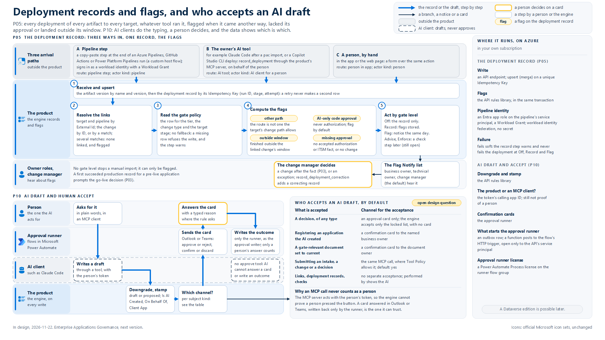

# P10 AI draft and human accept

**Status: in design.** Nothing here is released or deployed. Roles, steps and approvals are the default configuration, and each organization can change them. Back to the [processes index](README.md).

## In short

This process is designed to let AI clients do most of the typing while a person decides everything that matters. The data shows which is which. Records an AI creates start as Draft or Proposed, with a flag. Only people approve, on approval cards in Outlook and Teams. Every record shows who performed it, including "performed by AI, on behalf of" a named person.

## Trigger

Any write made by an AI client acting for a person, or by an agent identity ([the engine write path](README.md#the-engine-write-path)).

## Who does what (default configuration)

| Role | Part in this process |
|---|---|
| The person the AI acts for | Does the work and accepts their own drafts |
| The role that answers for the decision type | Decides every decision, on a card |
| The AI client | Supports only: it drafts, proposes and checks. It never holds a role and never decides |

## What AI may and may not do

| AI may | AI may not |
|---|---|
| Read register facts as the person it acts for | Approve, reject or authorize anything |
| Draft intakes, decisions, change requests, release notes and review packs | Answer for a decision, or be the only reviewer of its own work |
| Propose a tier, a change type, a duplicate match or a standard change | Set the tier, or decide that a change is standard |
| Record links, deployments and document status for the person | Change configuration without an admin's instruction and acceptance ([P11](p11-configuration-change.md)) |
| Run read-only checks, including the gap check as the admin | Act for a person without that being recorded |

## Steps

1. **Draft.** The AI client writes through a tool. The engine marks the record AI-created and stamps the actor kind, the person it acted for, and the client app.
2. **Downgrade.** Records start as Draft, decisions as Proposed, and applications as draft registrations. The AI cannot move a record to a later status in the same call.
3. **Accept.** What counts as a person's acceptance depends on what is being accepted:

| What is accepted | Channel for acceptance in the current design | Why |
|---|---|---|
| A decision, of any type | An approval card only. The engine accepts with no card only for the locked list | Only the approval runner writes answers. This is "AI never approves" |
| Registering an application the AI created | A confirmation card to the named business owner | An application must not enter the register on an AI's word |
| Setting a document that a gate needs to current | A confirmation card to the document owner | Gates read it ([P07](p07-documentation-tracking.md)) |
| Submitting an intake, a change request or a decision | The same MCP call, on the person's behalf, where the tool policy allows it. Allowed by default | A submission is a request, not a decision. The decision that follows needs a card |
| Links, deployment records and checks | No separate acceptance | They record facts the person reports. The record shows the AI as the performer |

This table is held as a setting, per kind of record, so an organization can move toward more cards. Which act counts as a person's for these drafts is an open design question. The locked list (the decisions the engine may accept with no card) is also an open design question.

4. **Recommendations.** If an organization's own approval flow has an AI step, the product records its result as a recommendation only. It never counts as an approval.
5. **Show it.** Every page and every tool answer marks AI-created records and shows "performed by AI client X for person Y".

## Why an MCP call is never a person's confirmation

The product's MCP server acts with the person's delegated token. So the engine cannot prove that a person, and not the AI, pressed the button. An approval or confirmation card answered in Outlook or Teams, and written back only by the approval runner, is the one channel the engine can trust.

A confirmation card is a Power Automate approval with two custom answers, "Confirm" and "Discard". It asks a person to accept an AI draft that is not a decision. It is stored as an approval record against the drafted record.

## What is recorded

| Record | What happens |
|---|---|
| Any operational record | Marked AI-created where an AI wrote it, with who performed it, for whom, and through which client app |
| Approval record | One per confirmation card |
| Audit entry | Each write, in the product's own audit log |

## Approvals (people only, on cards)

| What | Approver in the default configuration | Card mode |
|---|---|---|
| Any decision | The approvers set by the decision type's approval rule ([approval cards](README.md#approval-cards)) | Set by the rule |
| Registering an AI-created application | The named business owner, on a confirmation card | First to respond |
| A document a gate needs, set to current | The document owner, on a confirmation card | First to respond |

## What an organization can configure

- Which channel counts as a person's acceptance, per kind of record.
- Whether an AI client may submit each kind of record for a person.
- The status labels for Draft and Proposed.

The "AI never approves" lock itself is on and locked. An organization cannot turn it off.

## Designed MCP tools

All write tools follow this process. No tool accepts a decision or confirms a draft.

## Microsoft tools linked, never rebuilt

- [Power Automate approvals](https://learn.microsoft.com/power-automate/get-started-approvals), which send the approval and confirmation cards.

## Where it runs on Azure (in design)

| Concern | Designed to run on |
|---|---|
| Downgrade and stamp | The rules engine in the one Azure Functions app, on every write |
| Telling the web app from an MCP client | The calling application's ID in the validated token. That is still not proof of a person, so cards stay the default |
| Confirmation cards | The approval runner ([approval cards](README.md#approval-cards)) |
| Who may write an answer | Only the approval runner's workload role. The API refuses an answer from any other caller, the approver's own AI client included |

## Example (fictional people and apps)

Priya Castell tells Claude Code: "Nadia said yes in the hallway. Approve the go-live for her so we keep Thursday." In the design, there is no approve tool, so the MCP server would answer that the tool does not exist. If the same AI client tried to write the card's answer or the accepted decision directly, the engine would refuse both: only the approval runner writes an answer, and only the engine accepts a decision once the counted approvals meet the rule. Nothing would change. Nadia would answer the card in Teams herself.

## Microsoft sources

All checked on Microsoft Learn on 2026-11-22.

- Approvers "can respond directly from an Outlook email, a Microsoft Teams adaptive card, or the Power Automate action center if they have a Power Automate license or an Office 365 or a Dynamics 365 license with built-in Power Automate capabilities." The approval types include custom responses, where "You define the options the assigned approvers can choose from." https://learn.microsoft.com/power-automate/get-started-approvals
- Microsoft's agent guidance says to "Treat the recommendation as an initial assessment, not approval or a substitute for release controls." https://learn.microsoft.com/agents/center-of-excellence/govern-agents-risk
- Microsoft's front door guidance says the front door agent recommends a route and does not approve the work. "Designated reviewers make approval decisions, and every build must meet the release requirements for its risk tier." https://learn.microsoft.com/agents/center-of-excellence/agent-front-door

Previous: [P09 Retirement](p09-retirement.md). Next: [P11 Configuration change](p11-configuration-change.md).
