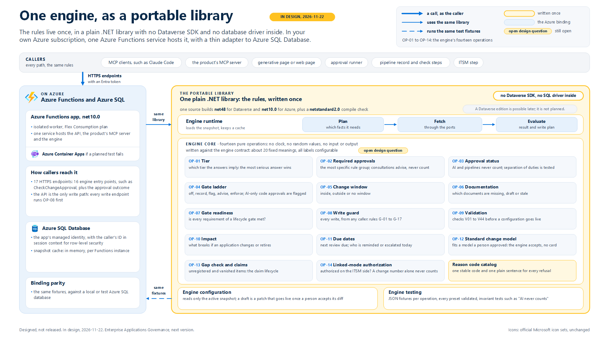
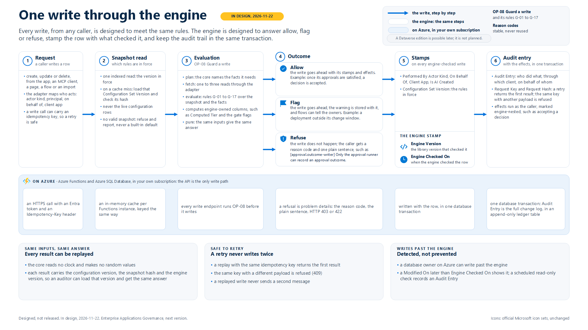

# Rules engine

**Status: built and tested; runs as a demo install with fictional data; no release yet.** This page describes the rules engine: the code that reads the configuration and checks the writes that reach it. It is in [`src/engine`](../../src/engine/), under the MIT License, with one JSON fixture per case in [`src/fixtures`](../../src/fixtures/README.md). Every build runs every fixture and every replay record. Where this page says "designed" or "planned", that part is not built yet.

## In one screen

| Question | Answer |
|---|---|
| What is it? | One plain .NET library, plus a thin adapter that binds it to Azure SQL Database. The library holds seventeen operations, from tier evaluation to configuration validation and the data taxonomy |
| Where does it run? | Inside the one service on Azure Functions, together with the API and the MCP server. The API is the only write path |
| What does it read? | Only the active configuration version's snapshot. Never the live configuration rows |
| What does a write get? | Allow, flag or refuse; a stamp of the engine version and the configuration version that checked it; and, for a tool call that writes, one audit entry in the same transaction |
| Whose rights? | Always the caller's. The engine never acts with more rights than the caller |
| What if configuration is broken? | It refuses governed writes and reports the problem. It never guesses or falls back to a built-in default |
| Is it portable? | Yes. The library has no database driver and makes no outbound calls, so the rules are written once and do not depend on one data store |

The diagram shows the callers on top, the library in the middle and an adapter on each side. The Azure adapter is the one built for the first release. The library compiles for more than one .NET target (.NET 10, .NET Framework 4.8 and .NET Standard 2.0, with its tests on the first two), so another data store could be added later without rewriting the rules. That is an option, not a plan.

## Ten rules the engine follows

1. **Configuration decides, code enforces.** The engine never branches on a fixed tier number, stage number, label or count. It reads configuration rows by key and compares ranks.
2. **The only fixed vocabulary is the engine contract,** a short list of meanings such as "accepted", "final" and "person". Every rule is written against those meanings, never against labels.
3. **AI never approves.** Only an approved answer from a person, signed in as a user, who holds the required role, counts. No setting turns this off.
4. **Roles come only through Entra groups.** The engine gets the caller's product roles from the validated token. It never reads a direct assignment as a role.
5. **Links, not copies.** The engine evaluates IDs, links, statuses and dates. It never fetches or stores another tool's content, and it makes no outbound calls.
6. **Pure core.** The library reads no clock, generates no random values and does no input or output. The same inputs and the same configuration snapshot always give the same answer.
7. **One engine, every path.** The web app, the MCP server, the approval runner and pipeline steps all reach the same rules.
8. **Refuse in plain words.** Every refusal carries a stable reason code and one plain sentence a person or an AI client can act on.
9. **Always as the caller.** The engine's own follow-on writes carry a marker that shows the engine made them inside an earlier operation, still under the caller's rights.
10. **No silent fallback.** A missing or broken configuration makes the engine refuse governed writes.

## Its parts

| Part | What it holds |
|---|---|
| Core | The contract records, the operations, the reason code catalog, the snapshot model and the hashing |
| Configuration | Reads and writes snapshots, applies a draft's patch, rebases a patch, reads seed and preset files, computes the difference and the summary |
| Runtime | Loads the snapshot, asks the core which facts it needs, fetches them, evaluates, and returns a write plan. Holds the snapshot cache |
| Testing | The fixture runner, the preset loader for tests and the invariant tests |
| Azure adapter | Reads and writes Azure SQL Database, maps the caller from the Entra token, and maps refusals to HTTP problem details |
| Host | The one Azure Functions app: the HTTP endpoints, the MCP server and the engine, in one process |

Two rules keep the parts honest. The core references no database driver, no JSON library and no logging library. And an adapter never contains a rule: if an adapter needs an "if" about tiers, approvals, stages or gates, that "if" moves into the core.

### Plan, fetch, evaluate

The core is pure, so it cannot read rows. Each operation runs in three steps:

1. **Plan.** The runtime asks the core which facts it needs for this request and this configuration. For example: "accepted decisions of the data use and go-live types for this application".
2. **Fetch.** The adapter runs those queries, usually one to three reads.
3. **Evaluate.** The core evaluates the request with the snapshot and the facts, and returns a result and, for writes, a write plan.

This makes every rule testable with facts written inline in a test file, with no database.

## The seventeen operations

| Operation | What it answers |
|---|---|
| Evaluate tier | Which tier do these answers suggest? The most serious answer wins |
| Resolve required approvals | Which approvals and consultations does this decision need in this scope, or may the engine accept it without a person's answer? |
| Evaluate approval status | Are the required approvals met, and which answers count? An answer from an AI, an agent or a pipeline never counts, and separation rules are applied here |
| Evaluate gate decision | At this gate level, what happens to this deployment: record, flag, warn or stop? |
| Check change window | Is this moment inside the change request's window? |
| Evaluate documentation completeness | Which required documents are missing, draft or stale? |
| Evaluate gate readiness | Is every requirement of this lifecycle gate met: a decision accepted, a document current or a review done? |
| Guard a write | May this caller make this change, what must be stamped, and what follows? |
| Validate a configuration set | Is this snapshot safe to activate, and what changed? |
| Walk impact | What breaks if this application changes or retires, and what does it need to run? |
| Compute due dates and reminders | When is the next review due, and who is reminded or escalated today? |
| Evaluate a standard change | Does this change fit a standard change model that a person approved? |
| Compare a gap check result | Which items are unregistered, which registered components vanished, and which claims change? |
| Evaluate linked-mode authorization | In linked mode, does the product know that the external change was authorized? A change number alone never counts |
| Resolve data domain | Who owns this business data domain, inherited from where, and which classification and rules apply? |
| Evaluate data use | Does this data use or copy need a decision, who is asked, and what is its state now? |
| Run data checks | What is missing, broken or waiting in the data: owners, deputies, decisions, mappings and locations? |

The three data operations are described in [Data taxonomy](data-taxonomy.md#engine).

Every operation returns the same shape: an outcome word, its own output, the reasons, a trace of the configuration rows that decided the outcome (which matched, which won, which dropped out), and the configuration version, snapshot hash and engine version it used. The `explain_rules` MCP tool returns that trace, so a person can see why a rule applied.

### Which rule applies

Approval rules and decision rights can be scoped by tier, lifecycle stage, change type, application kind, target stage and portfolio. Rows with the same decision type and scope form one rule group. For a record, the engine finds every group whose scope matches and applies the single most specific one, whole. Broader groups drop out. Ties are refused when the configuration is validated, so the engine never needs a hidden tie-break.

## One write through the engine

| Step | What the engine does | Fails when |
|---|---|---|
| 1. Identify the caller | Reads the calling principal and, when an AI client or a pipeline acted for a person, the person | The caller can't be identified |
| 2. Resolve the actor kind | Person, AI client for a person, agent identity, pipeline, approval runner or engine. Rows an AI client writes are marked as AI-created | Never |
| 3. Check the role | The caller must hold a product role that allows this write, through a bound group, an owner role on this application, or a workload grant | No role allows it |
| 4. Validate against configuration | Reads the configuration version in force: keys exist, status changes are allowed, required fields are set, gate requirements hold | A rule fails, or the configuration is broken. The error names the rule and the guideline |
| 5. Guard protected columns | Approval answers are written only by a person on the decision page, through `answer_approval` (D-38), and by the approval writer, which records an answer given on a card. Live configuration changes only inside activation. Accepted decisions, approval records and audit entries are append-only | Anyone else writes them |
| 6. Apply AI defaults | A row an AI client creates starts as Draft or Proposed | Never. It lowers the status instead |
| 7. Stamp | The configuration version, who performed it, the time, the engine version and the engine check time | Never |
| 8. Derive | Computes deployment flags, whether an approval counts, when a document goes stale and when a review is due | Never |
| 9. Audit | Writes an audit entry in the same transaction, and emits an event when a process needs to continue | Never fails the write |

On Azure, steps 1 to 9 run in one database transaction per write request.

## The gate ladder at run time

What each gate level does is fixed in the engine. Which level applies to a tier, change type and target stage is a configuration row. See [Configuration and presets](configuration-and-presets.md) for the presets.

| Gate level | When a deployment is recorded | When a pipeline check step asks before a deploy |
|---|---|---|
| Off | No flags | "Not governed" |
| Record | Outside window, other path and missing approval are recorded. Nobody is told | "Record" |
| Flag | The same flags, and the owners and named roles are told | "Record" |
| Advise | The same | "Warn", with the missing approvals and flags |
| Enforce | The same | "Stop", unless the approvals are complete or the emergency rule applies |

At enforce, each answer carries the row's fail mode, so a check step knows what to do if the product can't answer. A missing gate policy row is a broken configuration: the engine refuses and reports it.

**Open design question:** the change gate itself, meaning which levels ship by default and whether a check step should stop a deployment. The check operation is designed now and planned for a later release.

## Errors

A rule outcome is a result, not an error. "Not approved", "not ready", "outside window" and "stop" are normal answers. Errors are for refused writes, bad input and failures.

| Category | When | On Azure |
|---|---|---|
| Invalid input | A missing or malformed value, or an unknown key | HTTP 400 problem details |
| Refused | The guard refuses a write, or the caller lacks the role | HTTP 403 or 422 problem details |
| Not found | A referenced row does not exist | HTTP 404 |
| Conflict | An idempotency key reused with a different payload | HTTP 409 |
| Unavailable | No valid configuration in force, an unknown snapshot format, a hash mismatch, or a broken configuration such as a missing gate policy | HTTP 503 |
| Unexpected | A bug | HTTP 500, logged with the correlation ID, never a stack trace to the user |

Problem details follow RFC 9457: the type ends in the reason code, the title is the plain sentence, and the body lists the reasons and the correlation ID. Reason codes are lowercase, dot-separated and never reused, for example `approval.ai-actor-not-counted`. The catalog is designed to be published with each release.

## Idempotency

| Case | Design |
|---|---|
| Reads | Pure functions over a fixed snapshot, so naturally safe to repeat |
| Deployment records | Written once, keyed by the idempotency key the pipeline step sends. A replay returns the existing record |
| Other writes | An optional idempotency key. A replay with the same content returns the first result. The same key with different content is refused |
| Approval answers | Writing the same answer again does nothing. A different answer after a final one is refused |
| Activation | Activating a draft that is already activated returns its version and does nothing |
| Notifications | Keyed on the row and the version, so a replayed write never sends a second message |

## Determinism and replay

- **Same inputs, same output.** No clock (the time is an input), no random values and ordinal comparisons only.
- **Stable order.** Every list in a result is sorted by a stable key.
- **Canonical hashing.** The configuration hash is SHA-256 over a canonical JSON form.
- **Replay.** Each result carries the configuration version, the snapshot hash and the engine version. An auditor can load that version and the same facts and get the same answer.
- **Two kinds of change, never mixed.** A change in rule behavior is a new engine version with a release note and a new test. A configuration change is a new configuration version.

## Testing

| Layer | What |
|---|---|
| Fixtures | One JSON file per case, with a snapshot (a preset plus overrides), the context, the facts, the input and the expected outcome and reason codes. Fictional data only |
| Preset validation | Every shipped full preset, alone and with each allowed overlay, must validate with no errors |
| Invariant tests | Generated configurations and inputs check rules that must hold for any configuration. For example: an AI or workload actor never counts toward an approval; no decision outside the locked list is accepted without a person's answer; a consultation never counts; a change number alone never authorizes; a missing gate policy never falls back to a level; a more serious answer never lowers the tier; enforce never stops for the window or path alone; a configuration with the AI approval lock off never validates |
| One test per behavior change | Every change to a rule adds or changes a fixture |
| Binding tests | Designed: the same fixtures run through the Azure adapter against a test database, and must give the same outcome and reason codes as the library alone. Built today: the store conformance tests on SQLite and in memory, and a replay of the scripted walkthrough against the local server that must match the library's answers |

## The Azure binding

| Item | Design |
|---|---|
| Host | One Azure Functions app, isolated worker model, .NET 10, on the Flex Consumption plan |
| Same service | The REST endpoints, the MCP server and the engine in one app, all calling the engine in process |
| Fallback | Azure Container Apps, if the sign-in or MCP tests fail on Functions. The library and the adapter do not change |
| Database access | A SQL client with the app's managed identity. After opening each connection, the adapter puts the caller's object ID, actor kind, client app and roles in the session context, read-only for the life of the connection, so row-level security predicates can read them |
| Only write path | Database permissions allow ordinary writes only from the app's managed identity. Every write endpoint runs the guard first |
| Concurrency | Optimistic: an ETag from the row version, checked on update. A mismatch returns HTTP 412 |
| Description | An OpenAPI description generated from the endpoint contracts, published with each release |

Microsoft says Azure Functions 4.x on the isolated worker model supports .NET 10, and that .NET 10 or later apps on Linux need the Flex Consumption plan rather than the Consumption plan ([Learn](https://learn.microsoft.com/azure/azure-functions/dotnet-isolated-in-process-differences), checked 2026-11-22). The session context pattern is Microsoft's documented pattern for middle-tier apps where many people share one database user ([Learn](https://learn.microsoft.com/sql/relational-databases/security/row-level-security), checked 2026-11-22).

## Open design questions that touch the engine

| Question | The design's default |
|---|---|
| Is a short list of fixed engine meanings acceptable under "never hardcoded"? | Yes. About 20 fixed meanings, and every label stays configurable |
| When an admin tells an AI to change configuration, does the admin then accept the exact difference themselves? | Yes, on one decision page that shows the engine's difference |
| Do AI approvals from other tools count, such as a pull request approved only by an AI? | No. They never count as authorization, and the shipped gate default flags them |
| May the engine ever accept a decision without a person's answer? | Only for a locked list: lowest-tier intake, and standard changes whose model a person approved once |

If the first answer were no, the library would need a rule language, which would be a much larger piece of work.
