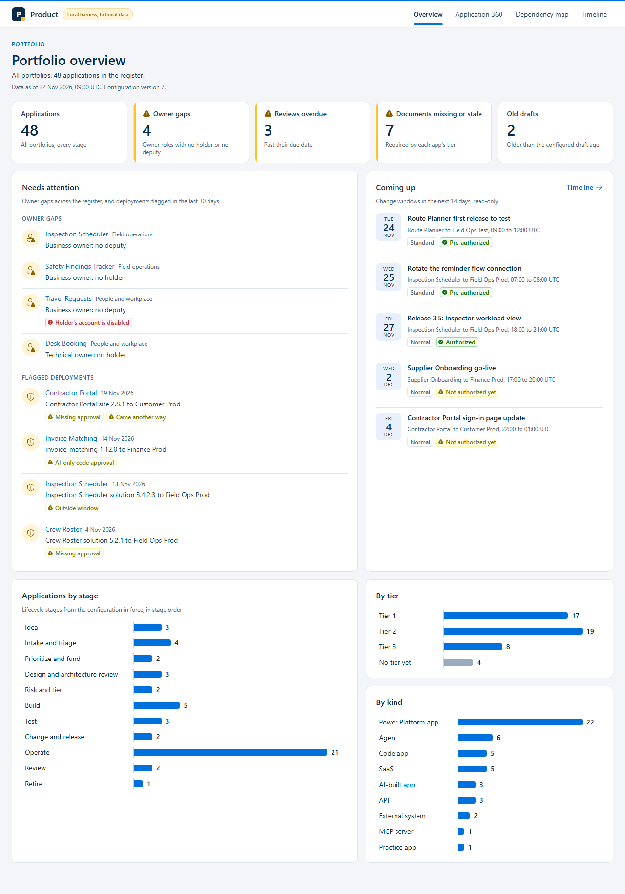
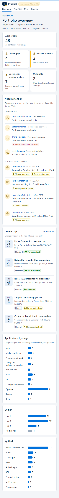
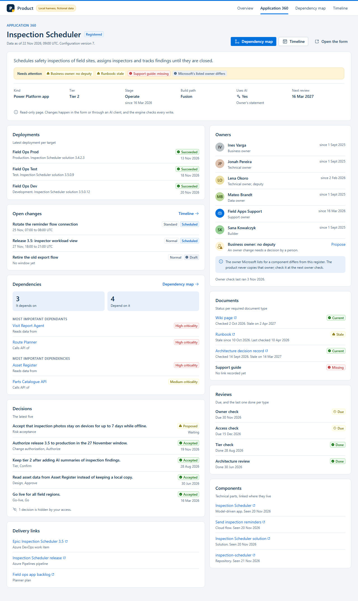
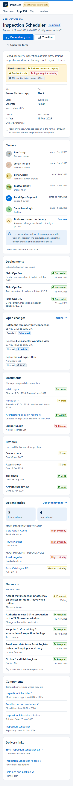
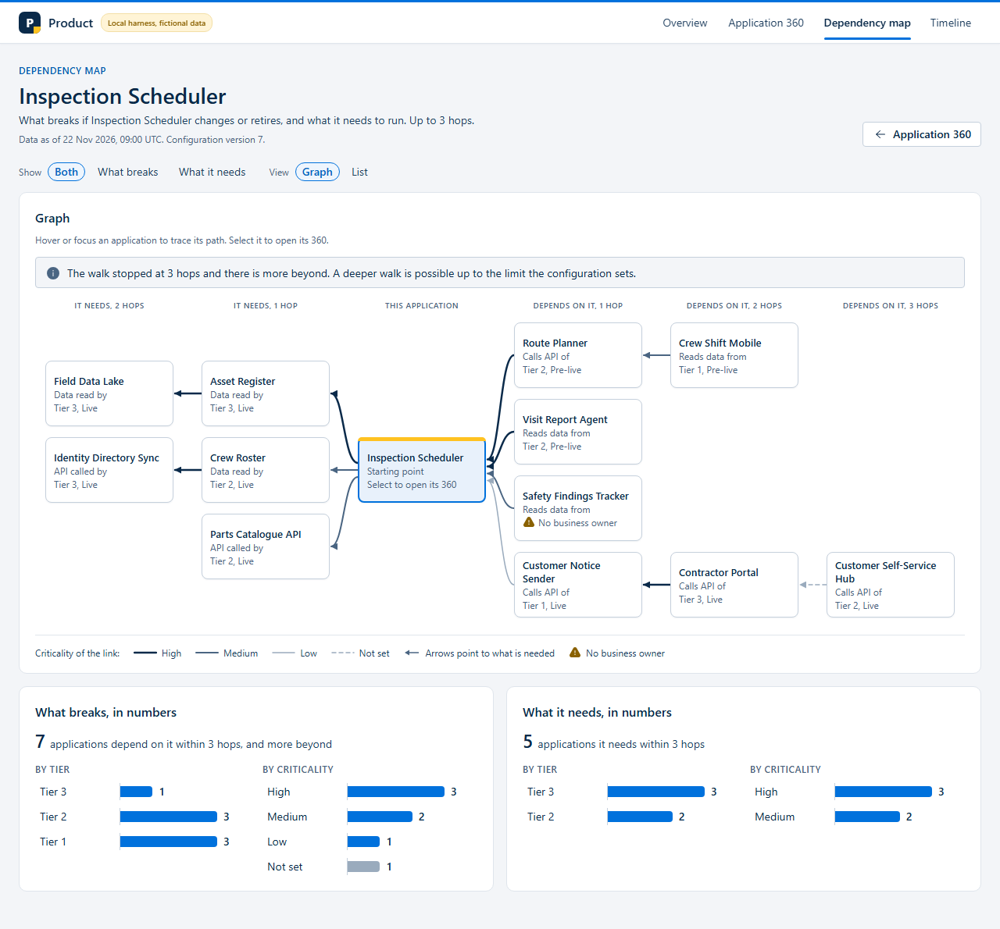
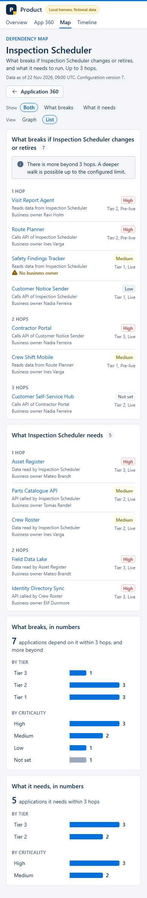
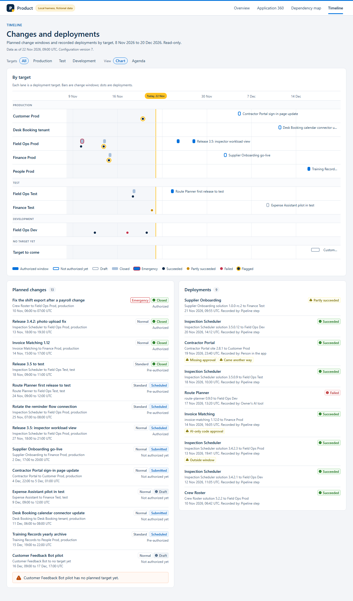
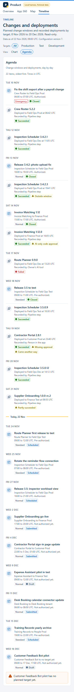

# Screens

**Status: built and tested; runs as a demo install with fictional data; no release yet.** This page describes the product's web app: the four first page designs in detail, and the work pages where a person acts. The code is React and shadcn/ui in [`src/ui`](../../src/ui/README.md), under the MIT License. The web app has its own unit tests, and browser end-to-end tests in [`src/tests/e2e`](../../src/tests/e2e/) play 23 demo scenarios at desktop width (1280 pixels) and phone width (390 pixels), performing every side sheet and every write the pages offer. The pictures below are screenshots of the four first pages with fictional data, at desktop and phone width.

The web app uses React and shadcn/ui (Radix primitives and Tailwind CSS), served by the same service as the API. It is designed to run in an organization's own Azure subscription; today it runs as a demo install with fictional data. Each page reads and writes through the same operations the MCP tools use. Each way in reaches the engine's write guard (OP-08): a person's write meets the same rules under the person's own roles, and an AI client's write also meets the AI rules.

## The work pages

Under [D-36](../decisions/D-36-the-web-app-acts-and-the-engine-checks-every-write.md), a signed-in person does their work in the web app. Beyond the four pages below, it has these pages, grouped as its menu groups them:

| Group | Pages |
|---|---|
| Home | My work |
| Work | Approvals, Intake, Changes, Reviews, Owners, Teams, Demand, Deployments, Documents, Gap check, Retirement |
| Register | Applications, Portfolios, Agents, Data, Places |
| Record | Decisions, Audit trail |
| AI | AI activity |
| Govern | Configuration, Roles and access, Guidelines, Measures, Admin |
| Demo | Demo guide, on a demo install only |
| Records | One page per record: an application, a decision (where a person answers an approval), an intake request, a change, a review, a data domain, location, mapping or use, a team, and more |

Each action is a side sheet that previews the write with the engine where the tool allows it, then writes and shows the engine's answer. A person answers an approval only on the decision page ([D-38](../decisions/D-38-a-person-answers-an-approval-on-the-decision-page.md)). On a demo install, an "Acting as" menu switches between the fictional people ([D-39](../decisions/D-39-the-demo-switches-roles-with-a-demo-only-persona-switch.md)), and the Demo guide opens each scenario step. The Data page is described in [Data taxonomy](data-taxonomy.md#screens). Each person's view is in the [guide per role](../../src/docs/README.md#the-guide-per-role).

## Rules for every page

| Rule | How the pages follow it |
|---|---|
| Light theme only | One light theme: navy text, a brand blue, and gold for attention and for "today". No dark theme |
| The engine decides | A page writes only through the product's tools, as the signed-in person. Each write goes through the engine's write guard, and the page shows the engine's answer, a refusal included, in the engine's words. Of the four pages below, the overview, the dependency map and the timeline only read; Application 360 also offers actions, such as declaring a data use |
| Numbers come from the server | Key figures come from the server, as fields of a tool's answer. A panel may count the rows it shows |
| Every number leads to rows | Each count and bar opens the matching list |
| Each panel fails on its own | Every panel holds the result of one call. A failure shows inside that panel, with the error and the correlation ID, and the rest of the page keeps working |
| Hidden rows are said, not shown | When the caller may not read something, the panel that owns it says so, for example "1 decision is hidden by your access" |
| Text people typed is data | Fields marked as untrusted render as plain text only. External links are HTTPS only and open in a new tab |
| Labels come from configuration | Status labels arrive with each value. Other keys are labeled from the active configuration |
| Fixed meanings drive the visuals | A badge's color and icon come from the fixed meaning, such as "accepted", never from the label |
| Status never by color alone | Every status badge has an icon and a text label. Charts have a legend and a list view with the same items |
| Phones | Below 720 pixels wide, every page is one column with 16-pixel side margins and no sideways scroll. Tables become lists, and the graph and the timeline open in their list views |
| Times | Shown in the viewer's time zone, with the zone named |

## Portfolio overview

**What it shows.** Five key figures across the register: applications, owner gaps, reviews overdue, documents missing or stale, and old drafts. The three that need someone get a gold bar and a warning icon when they are above zero.

Below them, "Needs attention" lists owner gaps and the deployments flagged in the last 30 days, with one badge per flag. Beside it, "Coming up" lists change windows for the next 14 days, with each change's type and authorization state. A standard change shows as "Pre-authorized".

At the bottom, three distribution bars show applications by stage (in the configured stage order), by tier (with "No tier yet" in gray) and by kind.

**Where the data comes from.**

| Panel | Tool |
|---|---|
| Key figures, applications by stage, owner gaps | `get_portfolio_summary` |
| By tier, by kind | `get_portfolio_summary` |
| Flagged deployments | `get_deployments` |
| Coming up | `get_change_schedule` |
| Owner role labels | `get_configuration` |

## Application 360

**What it shows.** One application on one page. The design below is its first, read-only form; the built page adds a Data panel with **Declare data use** and actions on its panels.

The header has the name, the registration status, when the data was read, and links to the dependency map and the timeline. A summary follows: the purpose, a "Needs attention" strip that repeats facts from the panels below (owner gaps, missing or stale documents, a failed last deployment, a Microsoft-listed owner who differs), and six facts: kind, tier, stage and since when, build path, AI use or the agreed autonomy level, and the next review.

Two columns follow. The left column has deployments (the latest per target, production first), open changes, dependencies (counts and the most important links), the latest five decisions and delivery links. The right column has owners and deputies, documents, reviews and components.

A decision the viewer may not read is shown as hidden, not left out. An owner gap offers "Propose", which hands over to `propose_owner_change`. It never assigns an owner.

On a phone the order is owners, deployments, changes, documents, reviews, dependencies, decisions, components and links.

**Where the data comes from.**

| Panel | Tool |
|---|---|
| Header, deployments, changes, dependencies, decisions, documents, reviews, components, delivery links | `get_application_card` |
| Owners, owner gaps, Microsoft-listed owner differences, last owner check | `get_application_owners` |
| Labels | `get_configuration` |

## Dependency map

**What it shows.** What breaks if an application changes or retires, and what it needs to run, up to three hops each way.

The map is a layered graph. What the application needs is on the left, by hops. The application is in the middle. What depends on it is on the right, by hops. Arrows point to what is needed. Line weight and style show how critical each link is (high, medium, low, or dashed when not set), with a legend. Each node shows the name, the relation in words (such as "Reads data from", or "Data read by" from the other side), and the tier and lifecycle, or "No business owner" with a warning icon.

Hovering over or focusing a node lights the path back to the application and dims the rest. Selecting a node opens its Application 360. The controls switch between both directions, "what breaks" and "what it needs", and between the graph and the list. A note says when the walk stopped at the depth limit with more beyond. Below the map, counts by tier and by criticality are shown for each direction.

**List view.** Every node, grouped by hops, with the relation sentence, the business owner (or the warning), the criticality, the tier and the lifecycle. It is the default on phones, and the path for keyboard and screen reader users. Every node can be reached from it.

**Where the data comes from.**

| Part | Tool |
|---|---|
| What depends on it | `get_dependency_impact`, direction "dependants" |
| What it needs | `get_dependency_impact`, direction "dependencies" |
| Relation words | `get_configuration`, for each dependency type's label and its label from the other side |

## Timeline

**What it shows.** Changes and deployments over time.

Each lane is a deployment target, grouped by target stage, production first. A "No target yet" group holds planned changes without a target. A week axis has a gold "Today" line, and the past is shaded.

Change windows are bars: solid blue when authorized, hollow blue when not yet authorized, hollow gray for a draft, pale blue when closed, and a red outline for an emergency. Deployments are dots: navy when succeeded, amber when partly succeeded, red when failed, with a gold ring when flagged. Hover or focus gives the details.

Below the chart, the same items appear as two lists: planned changes, with type, status and authorization, and deployments, with how each was recorded and any flags, such as a missing approval or an AI-only code approval. The timeline is read-only. There is no booking and no freeze calendar. Enforcing a window stays in your deployment tool. Filters: target stage, and chart or agenda.

**Agenda view.** One list by day, oldest first, with a "Today" rule. It is the default on phones.

**Where the data comes from.**

| Part | Tool |
|---|---|
| Change windows | `get_change_schedule` |
| Deployments | `get_deployments` |
| Labels | `get_configuration`, for target stages and deployment routes |

## Open points in the page designs

- The application card does not return the portfolio yet, so Application 360 shows no portfolio path. The card's contract could add it.
- A stage stepper on Application 360 would need the configured stage list as a third call.
- The dependency map makes one call per direction, because the impact answer does not mark the direction of each node.
- The depth is fixed at three in this design. A depth picker could offer from one up to the configured maximum.
